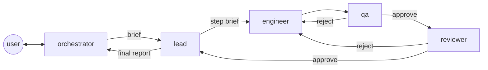

# baton work plan

Version 1.0, 2026-10-31.

baton hands a ticket to a team of Copilot CLI agents in tmux. The user talks to one agent, the **orchestrator**: it reads the ticket, plans the work as features and, once the user approves the plan, starts each feature. A feature gets its own git worktree and its own tmux session with four visible panes, one interactive Copilot CLI session per role: **lead, engineer, QA and reviewer**. They pass the work to each other in a fixed flow that the `baton` binary enforces, and the last handover is the user's: the orchestrator reports, and only the user's word pushes the branch and opens the pull request.

This document is the source of truth for scope and the work breakdown. How we work (rules, pipeline, quality gates) is canonical in [AGENTS.md](../AGENTS.md). Update the status markers as work lands.

**Contents**

0. [Status](#0-status)
1. [Goal and scope](#1-goal-and-scope)
2. [Facts](#2-facts)
3. [Design](#3-design)
4. [Decisions](#4-decisions)
5. [Risks](#5-risks)
6. [Open questions](#6-open-questions)
7. [Sources](#7-sources)

## 0. Status

The first milestone is a walking skeleton (`skeleton`): one feature on a throwaway repo, four panes, one full round of handovers and the final report, all with a stand-in `copilot`. Then a live run, then Jira, the guard and the pull request hosts, then Homebrew.

| Id | Step | Status |
| --- | --- | --- |
| `agent-wake` | Spike: wake-ups in an `--agent` session, a plugin's agent IDs, a plugin's hooks, the usage events (facts 3 to 10) | Done, findings in this plan |
| `agents-md` | AGENTS.md, this plan and the README | Done (#1) |
| `ci-baseline` | CI with mise and jactionlint; Renovate's config; the `main` ruleset and branch deletion on merge (decisions 22 and 23) | Done (#2) |
| `sonar` | SonarQube Cloud in CI, `mise run sonar-issues`, and the Sonar checks in the ruleset (decision 23) | Done (#5) |
| `go-toolchain` | The Go module, golangci-lint with the gates, the coverage gate and `mise run check`, with the first package: `internal/flow`, the roles and who works next (decision 13) | Done (#4) |
| `validate` | `flow.State.Validate`: whether `Start` and `Next` can make a state, so that a state read from disk gets checked; the state's names in JSON | Done (#6) |
| `state` | `internal/state`, reading: a feature's file in baton's folder, with its format and slug (decisions 24 and 25), checked when read, since `internal/flow` trusts the state it gets (decision 15) | Done (#7) |
| `store` | `internal/state`, writing: a new feature and its changes, under the feature's lock, each in a new file renamed over the old one, keeping the fields that a newer baton added (decision 24) | Done (#8) |
| `journal` | The feature's event log and notes, written with each change under its lock (decision 26) | Done (#9) |
| `repo` | `repo.CommonDir`: the repo's git common folder, which all its worktrees share, for baton's folder (fact 21) | Done (#10) |
| `handover` | `baton handover`: the role and the feature from the pane's environment (decision 29), the note and the verdict from its flags, and baton's folder under the git common directory (fact 21); the command line (decision 28) | Done (#11) |
| `status` | `baton status`: the repo's features, each with its holder, its round and its status (decision 30) | Done (#12) |
| `wait` | `baton wait`: blocks until the role has work, then records the pickup and prints the work (decisions 12 and 31) | Done (#13) |
| `tmux` | `internal/tmux`: a session with tiled, titled panes, whole or not at all, on a chosen socket, tested on `-L baton-test-<n>` (fact 22, decision 32); tmux through mise on Linux (decision 33) | In review (#14) |
| `worktree` | `internal/worktree`: the feature's branch and its worktree next to the repo | Todo |
| `plugin` | The baton plugin: the five agents and the hooks, embedded in the binary and written to the cache for `--plugin-dir` (decision 10) | Todo |
| `pane` | `baton pane <role>`: waits for the role's first work, then runs `copilot` with the role's flags (decisions 9 to 11); it ends when its terminal does, even without a hangup (fact 22) | Todo |
| `feature-start` | `baton feature start <slug> --brief <file>`: the state, the worktree, the tmux session with four titled panes (its name in tmux's alphabet, even for a repo named with dots, decision 32), and the first handover, to the lead | Todo |
| `skeleton` | The walking skeleton, end to end with the stand-in `copilot` | Todo |
| `orchestrator` | `baton start`: the orchestrator's session for the repo, and its `baton wait` for features that are ready or escalated and for questions | Todo |
| `ask` | `baton ask` and `baton answer`: a role's question goes to the orchestrator, and the answer comes back (decision 18) | Todo |
| `stop-hook` | `baton hook stop`: a role that ends its turn with work waiting, or without a `baton wait`, gets one more turn | Todo |
| `live-run` | A live run on a throwaway repo with a cheap model; the findings in a docs PR | Todo |
| `config` | The config file: the model per role, the round cap, the gate command, plan approval, the pull request host and base branch, per repo (decision 16) | Todo |
| `guard` | `baton hook guard`: role panes can't make outward actions; the orchestrator's pane asks the user for them and can't edit the code (decisions 17 and 19) | Todo |
| `gates` | The engineer's handover runs the repo's gate command and refuses a red one | Todo |
| `jira` | `baton jira <KEY>`: the ticket as text, from Jira's REST API with a read-only token in the Keychain (decision 6) | Todo |
| `deliver-github` | `baton deliver` for GitHub: push the branch and open the pull request with `gh`, the lead's final report as its body | Todo |
| `close` | `baton feature close <slug>`: ends the feature's session; keeps its branch and, unless asked, its worktree | Todo |
| `deliver-bitbucket` | `baton deliver` for Bitbucket Cloud: push the branch and open the pull request with the REST API, a token in the Keychain | Todo |
| `cost` | AI credits per role and per feature in `baton status`, from each session's events (decision 20) | Todo |
| `resume` | A pane whose `copilot` ended starts it again with `--resume`; the features carry on after a restart of the Mac | Todo |
| `homebrew` | A release tag and a formula in `codedogapp/homebrew-tap`; the docs install baton with Homebrew (decision 5) | Todo |

Ideas for later, not planned: a read-only page of the runs, like zeroshot's; approvals through nudge when the user is away (open question 1); other agent CLIs; Linux.

## 1. Goal and scope

**Goal.** The user gives the orchestrator a Jira ticket, or a plain request, in any repo on any of their Macs. The orchestrator plans it, the roles build each feature in its own worktree in the open, and the user gets a final report and decides what happens to the branch.

**In scope**

- One Go binary, `baton`, that needs only git, tmux and Copilot CLI (and `gh` for GitHub pull requests).
- The orchestrator's tmux session per repo, and a tmux session per feature with a pane per role.
- The flow, the round cap and the escalation to the user, enforced by the binary.
- Questions from the roles, answered by the orchestrator or, through it, by the user.
- The guard against outward actions, and plan approval.
- Jira tickets as input; GitHub and Bitbucket Cloud pull requests as output.
- The state on disk, so a run survives a restart; AI credits per role.
- Installation with Homebrew.

**Out of scope**

- Autopilot, headless or `-p` sessions for a role.
- A web page or any UI beyond tmux and the CLI (an idea for later).
- A postmortem after a feature.
- Agent CLIs other than Copilot CLI, and operating systems other than macOS. Linux runs only the tests, in CI.
- Writes to Jira.

## 2. Facts

Checked on 2026-10-31 with Copilot CLI 1.0.105 and tmux 3.8, unless a fact says otherwise. Facts 3 to 10 come from the `agent-wake` spike, which spent 5.27 AI credits with Claude Haiku 4.5.

1. **Flags** (`copilot --help`): `-i <prompt>` starts an interactive session with a first prompt; `--agent <id>`; `--plugin-dir <dir>`; `--session-id <uuid>` sets a new session's ID; `--resume`; `--model`, `--reasoning-effort`; `--allow-all` (tools, paths and URLs), `--allow-tool`, `--deny-tool`; `--available-tools` and `--excluded-tools`; `--no-ask-user`; `--disable-mcp-server`; `--max-ai-credits`; `--usage-output-file`; `--log-dir`. Environment: `COPILOT_HOME` (default `~/.copilot`).
2. **`-p` sessions** exit after one prompt and have no `ask_user` tool. MCP tools are named `<server>-<tool>`.
3. **Plugins.** `--plugin-dir` loads a plugin in the Agent Plugins 1.0 layout (`plugin.json` with `$schema`, agents in `com.github.copilot/agents/`, hooks in `com.github.copilot/hooks/hooks.json`) and in the legacy one (agents in `agents/`). A plugin's agent has the ID `<plugin name>:<agent name>`, for example `baton:lead`. A bare name fails, and the error lists the IDs.
4. **Hooks.** A plugin's hooks fire under `--plugin-dir`, and their commands inherit the pane's environment. `sessionStart` fires with the first prompt (its input has `source` and `initialPrompt`). `preToolUse` gets `toolName` (such as `bash`) and `toolArgs` (such as `command` and `mode`). Under `--allow-all` and `--no-ask-user`, a `preToolUse` answer of `ask` still shows a "Hook permission request" with the reason, the tool and its arguments, and the `notification` hook fires with the reason. An `agentStop` answer of `{"decision":"block","reason":…}` makes the reason the next prompt. Its input has `transcriptPath` and `stop_hook_active`. From the hooks reference: a command hook that fails or exits non-zero denies, but one that times out allows; the default timeout is 30 s; the CLI ends a turn after 8 blocks in a row.
5. **Wake-ups.** An idle interactive session started with `--agent` wakes when a shell it started in the background ends: the CLI shows "Waiting for background shells", the shell's end fires the `notification` hook and starts a turn, and the agent reads the output.
6. **`-i` with `--agent`** submits the prompt at once.
7. **Tools.** The default tool list includes `task`, `run_dynamic_workflow`, `dynamic_workflows_manage`, `read_agent`, `write_agent` and `list_agents`, which run agents the user can't see, plus `skill`, `sql` and the user's own MCP tools. `--available-tools` is an allow-list: the model sees only the listed tools, and an unknown name only prints "Unknown tool name in the tool allowlist". A short list also makes each turn cheaper: the first turn cost 0.91 AI credits with 9 tools against 2.78 with the default 29.
8. **Usage.** A session's events go to `$COPILOT_HOME/session-state/<session id>/events.jsonl`. Each model call adds a `session.usage_record`; each turn adds a `session.usage_checkpoint` whose `data.totalNanoAiu` is the session's total so far; `session.shutdown` has the final total, and `--usage-output-file` writes it as JSON at exit. One AI credit is 10⁹ nano AIU.
9. **Folder trust.** With `--allow-all`, a session in a new folder showed no trust prompt and added nothing to the trusted folders.
10. **Limits and models.** `--max-ai-credits` takes 30 at least, and the session tells the model its remaining credits. The `/model` picker shows no prices; it calls Claude Haiku 4.5, Claude Haiku 5.5 and GPT-6 Luna lightweight.
11. **tmux.** tmux 3.8 runs on the Mac (Homebrew). GitHub's `ubuntu-24.04` runner image doesn't list tmux; mise installs it from `aqua:tmux/tmux-builds`, static builds for Linux and macOS (newest: v3.7c).
12. **Typing into a pane** works (`tmux send-keys -l`, then `Enter`), but it mixes with the user's typing and with an open form in the pane.
13. **Jira.** Jira Cloud's REST API reads an issue at `https://api.atlassian.com/ex/jira/<cloudId>/rest/api/3/issue/<KEY>` with basic auth (email and a scoped API token). Atlassian's `acli` and its remote MCP server are the alternatives; some of the MCP server's tools spend Rovo credits.
14. **Bitbucket Cloud** opens a pull request with `POST /2.0/repositories/{workspace}/{repo}/pullrequests` and a token that has `write:pullrequest`. No Bitbucket CLI is installed.
15. **Lessons from an earlier private attempt** (a tmux launcher with an MCP dispatcher): orchestrators told to "only dispatch" did the work themselves; the `task` tool ran agents nobody could see; bash 3.2 and stacked panes caused trouble.
16. **Lessons from zeroshot** (an open-source meta-harness that the user tried and set aside; read, never used here): the flow, gates and round caps belong in the program, not in prompts; QA and review verdicts carry evidence; a run needs an event log and state on disk; Claude Haiku ignored a clear rejection twice, so the engineer needs a strong model.
17. **macOS.** `sleep` pauses while the Mac sleeps, so waits compare wall-clock times; macOS has no `timeout`. A binary replaced on disk stays stale in the processes that run it.
18. **SonarQube Cloud.** A new project's first analysis of `main` sets the new code's baseline and computes no quality gate (status `NONE`). The scan action, which waits for the gate, reports that as a failure; a rerun passes.
19. **macOS's `openat(2)`** (macOS 26.4.1, Go 1.27.3). With `O_CREAT` but not `O_EXCL`, it sometimes fails with "no such file or directory" while other openers make the same file in the same folder: with 20 openers at a time, 355 to 791 of 4,000 opens failed, with or without `O_NOFOLLOW`. `open(2)` with the file's full path never failed, nor did `O_CREAT|O_EXCL` followed, on "file exists", by an open without `O_CREAT` (0 of 4,000 each). `os.Root` opens files with `openat`, so baton makes its lock file with `O_EXCL`.
20. **`encoding/json/v2`** (Go 1.27.3) says "cannot" or "unable to" in its errors, picked at random once per process, so tests match the rest of the message.
21. **`git rev-parse --path-format=absolute --git-common-dir`** (git 2.56.0; the option came in git 2.31) prints the main worktree's `.git` folder from the main worktree, from its subfolders and from its linked worktrees, with symlinks resolved (`/private/var/…` for `/var/…` on a Mac). Outside a repo, it fails with exit code 128 and "not a git repository".
22. **tmux's rules** (tmux 3.8; CI runs 3.7c, and the tests use only what both have). A session target without `=` also matches the start of a name (`baton-x` finds `baton-x-demo`), and an empty target means the current session; `=name` matches the whole name, and an ID (`$1`, `@1`, `%1`) stays the same for its object's life. `new-session -e` puts its variables in the session's environment, so every later pane gets them; `split-window -e` gives them to its pane alone. tmux expands formats in `-c` and in `select-pane -T` (`#S` is the session's name, `#(…)` runs a command, `##` is a `#`), but not in `-e` or in the pane's command. An argument that ends in `;` ends the command, and `\;` stands for a `;`. `-c` with a missing folder starts the pane in the home folder, without an error. A program retitles its pane with an escape sequence unless the window's `allow-set-title` (tmux 3.5) is off; `select-pane -T` still works. `split-window -t <pane>` puts the new pane right after that pane, and `-d` keeps the active pane. A detached session takes its size from `default-size` (80×24), where four tiled panes fit. `new-session`, `split-window` and `select-layout` run their `after-*` hooks; `select-pane` doesn't. A hook runs in the client that ran the command, right after the command: what the hook prints follows the command's own output, and if the hook fails, tmux exits with 1 though the command did its work. tmux doesn't end while a job of `run-shell`'s runs, even after `kill-server`. A pane's program can miss the hangup when its session ends the moment the pane starts, and live on with a terminal that's gone (twice in about 900 such sessions); a program that reads its terminal ends then. `tmux -L` ignores `$TMUX`; without `-L`, tmux uses the server that `$TMUX` names. On macOS, a socket's path holds 104 bytes at most.

## 3. Design



**Commands.** `baton start` (or plain `baton`) opens the orchestrator for the current repo. The orchestrator runs `baton jira <KEY>`, `baton feature start <slug> --brief <file>`, `baton wait`, `baton answer`, `baton deliver <slug>` and `baton feature close <slug>`. A role runs `baton handover`, `baton wait` and `baton ask`. Copilot CLI runs `baton hook guard` and `baton hook stop`. tmux runs `baton pane <role>`. Anyone can run `baton status`.

**The flow** (decision 13). Each feature has one holder, the role whose turn it is. Only the holder hands over, and the binary picks the next role:

- the orchestrator's brief goes to the lead, who writes the step brief for the engineer;
- the engineer hands over to QA;
- QA approves to the reviewer, or rejects to the engineer;
- the reviewer approves to the lead, or rejects to the engineer;
- the lead commits on the feature's branch and hands the final report to the orchestrator, and the feature is ready.

A round is one pass of the engineer. A rejection starts the next round, with the rejecting note attached. The third rejection doesn't go to the engineer: the feature is escalated, and the orchestrator gets it and asks the user. On the user's word, the orchestrator hands it back to the engineer for one more round, or to the lead with a new brief, or closes it. A new brief starts the rounds again. QA and the reviewer must hand over with `--verdict approve|reject`; their note gives the evidence (the commands they ran and what came out, each criterion checked) and, for a rejection, the findings, each marked blocking or non-blocking.

**The final handover is the user's.** When a feature is ready, the orchestrator tells the user its branch, the lead's report and the open findings. The user decides: deliver it (`baton deliver` pushes the branch and opens the pull request), send it back with changes (a new brief to the lead, and the round count starts again), or close it.

**Panes** (decisions 9 to 11 and 32). `baton feature start` makes the worktree `../<repo>-<slug>/` on a new branch, and a tmux session `baton-<repo>-<slug>` with four tiled panes titled lead, engineer, qa and reviewer (`pane-border-status top`, and `allow-set-title off` so that the titles stay), set on that session's window only. Each pane runs `baton pane <role>`, which waits without a model until the role's first work arrives, then runs:

```sh
copilot --agent baton:<role> --plugin-dir <cache>/plugin --model <model> \
  --session-id <uuid> --allow-all --no-ask-user \
  --available-tools bash read_bash stop_bash list_bash view create edit grep glob web_fetch \
  -i "<the role's work: read the note at …>"
```

with `BATON_ROLE` and `BATON_FEATURE` in its environment. baton keeps each role's session ID, so it can find the role's events and resume the session. The orchestrator's pane runs the same way, as `baton:orchestrator`, but keeps `ask_user` (the user talks to it) and the user's nudge tools (`nudge-ask`, `nudge-report`) for when the user is away.

**Handover and wake-up** (decision 12). `baton handover --note <file> [--verdict …]` checks the move, stores the note as `notes/NN-<from>-to-<to>.md`, logs the event and makes the next role the holder. The role then starts `baton wait` in a background shell and ends its turn. `baton wait` looks for the role's work every second (decision 31); once the role has some, it records the pickup, prints the work (the round, the note's writer and their verdict, and the note's path) and exits; its end wakes the role (fact 5). The `agentStop` hook is the safety net: a role that ends its turn with work waiting, or without a running `baton wait`, gets one more turn that tells it what to do, once per stop (`stop_hook_active`). Typing into the pane stays the fallback (fact 12).

**Questions** (decision 18). A role never asks the user. `baton ask "…"` stores the question and waits for its answer; the orchestrator's `baton wait` wakes it, and it answers from the plan with `baton answer <id> "…"`, or asks the user first, in its pane or through nudge.

**Safety** (decisions 9, 17 and 19). The roles run with every permission (`--allow-all`) and no `ask_user`, so nothing waits on a prompt in a pane nobody watches, and with the tool allow-list, so no hidden agent and none of the user's skills or MCP tools. The guard hook (`preToolUse` → `baton hook guard`) denies outward actions in a role's pane: `git push`, pull request and merge commands, `gh api` writes, HTTP writes with `curl`, Jira writes, `baton deliver` and `tmux`. In the orchestrator's pane, it answers `ask` for outward actions, so the user approves each one, and for `baton feature start` while plan approval is on (decision 8); and it denies `edit` and `create` outside baton's state, so the orchestrator plans and dispatches but doesn't write the code. The guard only matches text, quickly, because a hook that times out allows (fact 4).

**State** (decision 15). Everything lives in `$(git rev-parse --git-common-dir)/baton/`, which every worktree of the repo shares and git never commits:

- `features/<slug>/feature.json`: its format (decision 24), the slug (decision 25), the branch and worktree, the holder, the round and its cap, the status (`running`, `escalated`, `ready`, `delivered`, `closed`), each role's session ID, and the holder's work: its note, the note's writer and their verdict, and whether the holder picked it up (decision 31);
- `features/<slug>/events.ndjson`: one JSON line per event (start, handover, pickup, question, answer, escalation, push and pull request), with its time, the role that acted, its verdict, its note, and where the feature stands after it;
- `features/<slug>/notes/`: the briefs, the handover notes and the final report, each named `NN-<from>-to-<to>.md`, from the role that acted to the holder after it;
- `features/<slug>/lock`: the feature's lock, a file that baton never replaces;
- `questions/<id>.json`: open questions and their answers.

Every change takes an exclusive lock on the feature (`flock` on its `lock` file, which the kernel releases when the process ends), writes a new file and renames it over the old one, so a reader, who takes no lock, sees the old state or the new one. Every change logs its event, and keeps its note if it has one, in the same hold of the lock (decision 26).

**Config** (decision 16). `baton` reads `config.json` in its folder under `os.UserConfigDir()` (`~/Library/Application Support/baton/` on a Mac): defaults, plus a section per repo, keyed by the remote's URL, so nothing goes into a work repo. The settings: the model and reasoning effort per role, an AI credits cap per role, the round cap (3), plan approval (on), the gate command, the branch prefix, the base branch (by default the remote's default branch), the pull request host (by default from the remote's URL), and Jira's site and email. Tokens never go into the file: they live in the login Keychain.

**Jira** (decision 6). `baton jira DEMO-1` prints the ticket's summary, type, status, description (Atlassian Document Format turned into Markdown), subtasks, links and comments. It reads the token from the Keychain with `/usr/bin/security`, and the site's `cloudId` from the site.

**Delivery.** `baton deliver <slug>` pushes the branch and opens the pull request against the base branch, titled from the brief, with the lead's final report as its body: on GitHub with `gh pr create`, on Bitbucket Cloud with its REST API and a token from the Keychain. It never merges.

**Cost** (decision 20). `baton status` sums each role's AI credits from the last `session.usage_checkpoint` in its events (fact 8) and shows them per feature, with the holder, the round and the status.

## 4. Decisions

Decisions marked **lead's call** are the lead's, for the user's end review. The user can change any of them before the code depends on it; the repo is cheap to rename or make private now.

1. **baton is its own tool**: the user's choice (2026-10-31), after a spike of zeroshot. Not built on zeroshot or Omnigent; their ideas are welcome, their code isn't (fact 16).
2. **`codedogapp/baton`, public** (lead's call): like nudge, it holds no secrets and nothing about any work project.
3. **The name `baton`** (lead's call): the roles pass the baton, and the user takes the last handover.
4. **One Go binary** (lead's call): no bash scripts and their bash 3.2 trouble (fact 15); one file to install; the flow in tested code.
5. **Homebrew, `codedogapp/tap/baton`** (lead's call): a formula that builds baton from its tag's source, as nudge's did. The tap's state is to be checked at the `homebrew` step, since nudge left it.
6. **Jira's REST API with a scoped, read-only token** (lead's call): nothing else to install, and no Rovo credits. The token (`read:jira-work`) lives in the login Keychain, which the user fills.
7. **Claude Opus 5.5 for every role** (lead's call), configurable per role. A weaker engineer ignored rejections in zeroshot's spike (fact 16).
8. **Plan approval on** (lead's call), configurable. The guard makes the user approve each `baton feature start` in the orchestrator's pane, so an orchestrator can't skip it.
9. **The roles run with `--allow-all` and `--no-ask-user`, guarded by a hook** (lead's call, flagged): the CLI's own prompts would stop a role in a pane nobody watches, and a role can't approve its own tools. The guard keeps outward actions out of the role panes (fact 4), and the orchestrator, whom the user watches, keeps `ask_user`.
10. **A tool allow-list per role (`--available-tools`)** (lead's call): it removes `task` and every other tool that runs hidden agents, the user's skills and MCP tools, and it fails closed when a new CLI version adds such a tool (fact 7). An exclude list would fail open.
11. **The agents and hooks ship as a plugin** (lead's call): the binary embeds the plugin, writes it to its cache and passes it with `--plugin-dir`, so `~/.copilot/` stays untouched and the agents are `baton:<role>` (fact 3), clear of the user's own agents.
12. **Wake-ups through `baton wait`** (lead's call): a background shell's end wakes the role (fact 5), and nobody types into a pane. The first work starts the pane's `copilot` (`baton pane`), so a role spends nothing before it has work. The stop hook catches a role that forgets to wait; typing into the pane is only the fallback.
13. **The binary owns the flow** (lead's call): the next role, the round count, the cap of three rounds and the escalation to the user live in `internal/flow`, with tests. After an escalation, the user's word buys one more round at a time.
14. **A session per feature, on the user's tmux server** (lead's call): `baton-<repo>-<slug>`, next to the orchestrator's `baton-<repo>`. baton changes only the sessions it made, and only their own options. Tests and live checks use their own sockets.
15. **The state lives under the git common directory** (lead's call): shared by the repo's worktrees, never committed, no file in the work repo; a lock and atomic renames keep it whole.
16. **The config is JSON** (lead's call), where the proposal had TOML: Go's standard library reads JSON, and nudge's settings file is JSON too. It lives outside the repo, keyed by the remote's URL.
17. **Outward actions only through `baton deliver`, in the orchestrator's pane, on the user's approval** (lead's call). The roles never push; the lead commits locally.
18. **Roles ask the orchestrator, never the user** (the user's rule): `baton ask` blocks the role until `baton answer`.
19. **The orchestrator can't write the code** (lead's call): the guard denies its `edit` and `create` outside baton's state (fact 15).
20. **Cost from the session's own events** (lead's call): the last `session.usage_checkpoint` per role's session (fact 8), read while the feature runs; no extra flags.
21. **Waits poll every second and compare wall-clock times** (lead's call): simple, and right after the Mac sleeps (fact 17). No file-watching dependency.
22. **Branches are deleted on merge** (lead's call): like Bakhyard, unlike nudge, as the user asked when baton started. The `main` ruleset is nudge's: no deletion, no force push, changes only through pull requests (no approvals needed), and the required checks; the wiki is off, as in nudge.
23. **SonarQube Cloud joined CI in its own step** (lead's call): it needed a project and a `SONAR_TOKEN` secret that only the user could make (nudge's token is a secret of nudge's repo, not of the organisation), and the user made them on 2026-10-31. Until then, CI ran `mise run check` alone. No job that skips itself without the token: a gate that can turn itself off would hide a lost secret later.
24. **The feature's file carries its format** (lead's call), a number that changes only when an older baton would misread the new layout. baton reads the format first and refuses a newer one with "run the newer baton", since a `baton wait` or `baton pane` can outlive an upgrade (risk 8). A new field at the top of the file keeps the format: an older baton ignores it and, when it writes the file, keeps it. A new field inside `flow` would be lost in that write, so it changes the format.
25. **A slug is lowercase words of letters and digits, joined by hyphens** (lead's call), such as `demo-1`: it names the feature's folder, branch and tmux session, and is safe in all three.
26. **A change, its note and its event are written in one hold of the feature's lock, in that order** (lead's call). The feature's file is the truth, and renaming it makes the change. The note comes first, as a new file that nothing names yet, so the next role never gets a note that isn't there. The event comes last, so the log never shows a change that didn't happen. A crash between them can leave a note that nothing names, or a change missing from the log; an event that can't be written after the change is reported as such. A crash in the middle of a line of the log leaves half of it, and the next event starts a line of its own. A note takes the number after the folder's highest one, so a missing or stray file never makes two notes share a name.
27. **baton runs the user's own git, tmux, Copilot CLI and gh, found on the user's `PATH`** (the user's call, 2026-10-31), as the user's shell does. Sonar's go:S4036 ("OS commands should not rely on PATH resolution") wants fixed paths, which would miss the tools that Homebrew and mise install, and Go already refuses a program found in a relative folder of the `PATH` (`exec.ErrDot`). The one place that runs each tool carries `// NOSONAR`, with the reason next to it.
28. **The command line uses the standard library's `flag` package, a flag set per command** (lead's call): no dependency for a handful of commands. The `main` package only wires the process (its arguments, environment, working folder, output and Ctrl-C) to `internal/cli`. A command that baton refuses, or that fails, prints its reason and exits with 1; a command line that doesn't parse prints the usage and exits with 2.
29. **A role's pane names its role and its feature** (lead's call): `baton pane` sets `BATON_ROLE` and `BATON_FEATURE`, and `baton handover`, `wait` and `ask` read them there, not from flags, so a role can't act for another role or feature by a slip of a flag. It's a convention, not a boundary: a shell can set them, and the flow checks only that the role holds the feature.
30. **`baton status` lists every feature, or fails** (lead's call). It lists the folders in `features/` by slug, and skips what isn't a feature's folder, and a feature's folder that Create hasn't written the file into yet. A feature's file that baton can't read or check fails the whole list, with the file's path in the error, rather than leaving the feature out of the list and out of mind.
31. **The feature's file names the holder's work, and `baton wait` takes it under the feature's lock** (lead's call). A note goes from the role that acted to the holder after the change, so it becomes the holder's `work`: the note, its writer, their verdict, and whether the holder picked it up. The store refuses a new feature, or a move to another holder, without a note, so the holder always has work. `baton wait` tries every second to mark the work picked up, under the lock, and logs the pickup before it prints the work, so of two waits of a role only one gets it. It refuses a role that holds the feature and has picked up its work, and a role that baton doesn't know, since nothing could end their wait. `work` sits at the top of the file, so it keeps the format (decision 24).
32. **`internal/tmux` makes a session whole or not at all, and takes the caller's text as it is** (lead's call; fact 22). It refuses a session without panes; a name other than letters, digits, hyphens and underscores, which tmux keeps as it is and baton finds exactly (`=name`); and a folder that isn't an absolute path to a folder, where tmux would quietly start the panes in the home folder. It escapes each `#` and a final `;`, which tmux would expand or take for the end of a command. A pane's environment stays in that pane: the first pane's variables come back out of the session's environment. The options go on the session's window, never the server's (decision 14): the titles in the top borders, and `allow-set-title off`, so a role's program can't retitle its pane; that option needs tmux 3.5. Once tmux has printed the new session's IDs, baton ends the session by its exact name if anything fails after, a hook of the user's included, or if Ctrl-C stops it; Ctrl-C during `new-session` itself may leave the session. A name that tmux has already fails before anything changes. baton reads only the first line that a command prints, since the user's hooks may print after it.
33. **tmux from mise on Linux only** (lead's call): CI's runner has no tmux (fact 11), so mise installs tmux-builds there. On a Mac, mise leaves `tmux` alone, so that in the repo it stays the user's own, the one that runs the user's server (decision 27).
34. **The one place that runs each tool carries `//nolint:gosec` too, with its reason** (the user's call, 2026-10-31), as does the tests' own place that runs tmux. gosec's G204 ("subprocess launched with variable") wants constant arguments, but each tool needs the feature's own: a checked name, IDs and text that reach the tool as arguments, which no shell reads (fact 22).

## 5. Risks

1. **Wake-ups aren't a documented contract** (fact 5). A CLI update could break them. The stop hook and typing into the pane are the fallbacks, and `live-run` checks the whole loop.
2. **The guard matches text** (decision 9): a role can reach the network in ways no pattern catches (a script, another tool). It is a seatbelt, not a sandbox. Taking the role panes' credentials away (an empty `GH_CONFIG_DIR`, a git `pushInsteadOf` that fails) would add a second belt; `guard` checks whether that works.
3. **`--allow-all` lets a role read and write any path** on the Mac. Roles work in their worktree by their instructions, and the guard watches outward actions only.
4. **A hook that times out allows** (fact 4): the guard must answer within its timeout and never wait on anything.
5. **AI credits**: four Opus sessions per feature, three of them in every round, plus the orchestrator. The per-role cap (`--max-ai-credits`, decision 16) and `baton status` keep it visible; the round cap bounds it.
6. **The user's own instructions apply in every pane**: Copilot CLI loads the user's and the repo's custom instructions, which may disagree with a role's prompt.
7. **The CLI changes fast**: flags, tool names and event fields can change. The facts carry the version they were checked with; `live-run` repeats the checks.
8. **Processes outlive an upgrade** (fact 17): a running `baton wait` or `baton pane` keeps the old binary, so the feature's file carries its format, and an older baton refuses a newer format and keeps the fields it doesn't know (decision 24).
9. **Floating tool versions**: mise tools use `latest` with no lockfile, so a new release (a new jactionlint rule, say) can turn CI red with no change in the repo, and a local run may use an older version than CI until `mise upgrade --local`. When CI turns red for no reason, check the tool versions first.

## 6. Open questions

1. **Approvals when the user is away**: the guard's `ask` shows only in the orchestrator's pane. Should `baton deliver` also ask through nudge, so the user can approve from the phone? Until decided, outward actions wait for the user at the Mac.
2. **Things only the user can do**: the Jira token and site (`jira`); the Bitbucket token and workspace (`deliver-bitbucket`). Done on 2026-10-31: the Renovate GitHub App, and the SonarQube Cloud project with its `SONAR_TOKEN` (`sonar`).

## 7. Sources

- Copilot CLI: `copilot --help` and `copilot help config|environment|permissions` (1.0.105); the hooks reference, the plugins overview and the CLI plugin reference on docs.github.com; the `agent-wake` spike (facts 3 to 10).
- tmux 3.8 manual; [tmux/tmux-builds](https://github.com/tmux/tmux-builds); GitHub's [runner images](https://github.com/actions/runner-images).
- Jira Cloud REST API v3 and Bitbucket Cloud REST API 2.0 reference.
- Bakhyard's AGENTS.md (the pipeline baton runs), nudge (this repo's rules, CI and gates), zeroshot (ideas only, fact 16).
