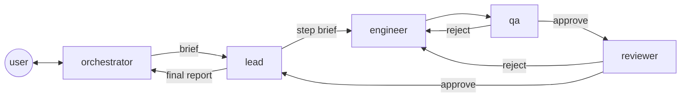

# baton work plan

Version 1.0, 2026-10-31.

baton hands a ticket to a team of Copilot CLI agents in tmux. The user talks to one agent, the **orchestrator**: it reads the ticket, plans the work as features and, once the user approves the plan, starts each feature. A feature gets its own git worktree and its own tmux session with four visible panes, one interactive Copilot CLI session per role: **lead, engineer, QA and reviewer**. They pass the work to each other in a fixed flow that the `baton` binary enforces, and the last handover is the user's: the orchestrator reports, and only the user's word pushes the branch and opens the pull request.

This document is the source of truth for scope and the work breakdown. How we work (rules, pipeline, quality gates) is canonical in [AGENTS.md](../AGENTS.md). Update the status markers as work lands.

**Contents**

0. [Status](#0-status)
1. [Goal and scope](#1-goal-and-scope)
2. [Facts](#2-facts)
3. [Design](#3-design)
4. [Decisions](#4-decisions)
5. [Risks](#5-risks)
6. [Open questions](#6-open-questions)
7. [Sources](#7-sources)

## 0. Status

The first milestone is a walking skeleton (`skeleton`): one feature on a throwaway repo, four panes, one full round of handovers and the final report, all with a stand-in `copilot`. Then a live run, then Jira, the guard and the pull request hosts, then Homebrew.

| Id | Step | Status |
| --- | --- | --- |
| `agent-wake` | Spike: wake-ups in an `--agent` session, a plugin's agent IDs, a plugin's hooks, the usage events (facts 3 to 10) | Done, findings in this plan |
| `agents-md` | AGENTS.md, this plan and the README | Done (#1) |
| `ci-baseline` | CI with mise and jactionlint; Renovate's config; the `main` ruleset and branch deletion on merge (decisions 22 and 23) | Done (#2) |
| `sonar` | SonarQube Cloud in CI, `mise run sonar-issues`, and the Sonar checks in the ruleset (decision 23) | Done (#5) |
| `go-toolchain` | The Go module, golangci-lint with the gates, the coverage gate and `mise run check`, with the first package: `internal/flow`, the roles and who works next (decision 13) | Done (#4) |
| `validate` | `flow.State.Validate`: whether `Start` and `Next` can make a state, so that a state read from disk gets checked; the state's names in JSON | Done (#6) |
| `state` | `internal/state`, reading: a feature's file in baton's folder, with its format and slug (decisions 24 and 25), checked when read, since `internal/flow` trusts the state it gets (decision 15) | Done (#7) |
| `store` | `internal/state`, writing: a new feature and its changes, under the feature's lock, each in a new file renamed over the old one, keeping the fields that a newer baton added (decision 24) | Done (#8) |
| `journal` | The feature's event log and notes, written with each change under its lock (decision 26) | Done (#9) |
| `repo` | `repo.CommonDir`: the repo's git common folder, which all its worktrees share, for baton's folder (fact 21) | Done (#10) |
| `handover` | `baton handover`: the role and the feature from the pane's environment (decision 29), the note and the verdict from its flags, and baton's folder under the git common directory (fact 21); the command line (decision 28) | Done (#11) |
| `status` | `baton status`: the repo's features, each with its holder, its round and its status (decision 30) | Done (#12) |
| `wait` | `baton wait`: blocks until the role has work, then records the pickup and prints the work (decisions 12 and 31) | Done (#13) |
| `tmux` | `internal/tmux`: a session with tiled, titled panes, whole or not at all, on a chosen socket, tested on `-L baton-test-<n>` (fact 22, decision 32); tmux through mise on Linux (decision 33) | Done (#14) |
| `worktree` | `repo.MainWorktree` and `repo.Worktree.Add`: the repo's main worktree, which the features' worktrees go next to, and a feature's branch and worktree, both or neither (fact 23, decision 35) | Done (#15) |
| `plugin` | `internal/plugin`: baton's plugin, the roles' agents, embedded in the binary and written whole to baton's cache for `--plugin-dir`, in a folder named by its files (fact 24, decisions 11, 36 and 37) | Done (#16) |
| `pane` | `baton pane`: in a role's pane, finds `copilot` and writes the plugin, waits for the role's first work and picks it up, then becomes the role's `copilot`, with the role's flags, the work as its first prompt, and `COPILOT_ALLOW_ALL=true`, which trusts the worktree (decisions 9 to 11, 36, 38 and 39); it stops waiting when its terminal's input ends, even without a hangup (facts 22 and 25) | Done (#17) |
| `undo` | `state.Store.Remove` and `repo.Worktree.Undo`: what `baton feature start` undoes when a later part fails, so that a failed start leaves no feature, branch or worktree behind (decision 40) | Done (#18) |
| `feature-start` | `baton feature start <slug> --brief <file>`, in the orchestrator's pane or the user's shell: the feature, with the brief as the lead's work; its branch `feature/<slug>` and its worktree; and its tmux session, with four titled panes, each running this baton's `baton pane` with `BATON_ROLE` and `BATON_FEATURE` in its environment (decisions 29, 41 and 42). A part that fails undoes the others (decision 40); baton also stops on SIGHUP, as on Ctrl-C, so that a closed terminal or pane doesn't leave the branch (fact 23) | Done (#19) |
| `skeleton` | `TestSkeleton`, the walking skeleton: in a throwaway repo, `baton feature start` starts a feature, the stand-in `copilot` (`testdata/copilot`) plays each role through one round of handovers, and the orchestrator's `baton wait` picks up the lead's final report, with the commit on the feature's branch (decision 43) | Done (#20) |
| `orchestrator-flow` | The orchestrator's `baton wait` and `baton handover`, in its pane, which names no feature (decision 44): the wait picks up the work of any feature that is ready or escalated, and refuses when no feature runs; the handover names the feature and the next role, `baton handover <slug> --to <role>`: the lead, with a new brief, or, after an escalation, the engineer, for one more round | Done (#21) |
| `orchestrator` | `baton start`, or plain `baton`, in the user's shell: the orchestrator's tmux session `baton-<repo>`, made in the repo's main worktree unless it runs already, then shown in the user's terminal, attached outside tmux and switched to inside it. Its pane's `baton pane` becomes the orchestrator's `copilot` at once, with the orchestrator's agent in the plugin, `ask_user` and the user's nudge tools, and copilot's own prompts (decision 45) | Done (#22) |
| `ask` | `baton ask` and `baton answer <slug>`: the holder's question goes to the orchestrator, whose `baton wait` picks it up, and the answer comes back to the role's `baton ask`; one question at a time, in the feature's file, and no handover while it waits; the roles' prompts say how to ask, and the orchestrator's how to answer (decisions 18, 37 and 46) | Done (#23) |
| `stop-hook` | `baton hook stop` and its `agentStop` hook in the plugin, which runs the pane's baton through `BATON_BIN`: `baton wait` and `baton ask` mark their role as waiting while they wait, and a pane's `copilot` that ends its turn without that mark gets one more turn, which tells it to start `baton wait`, to ask its question again, or to finish its part and hand over; the orchestrator, too, while a role holds a feature or work waits for it (decision 47) | Done (#24) |
| `live-run` | A live run on a throwaway repo with a cheap model; the findings in a docs PR (facts 26 to 30) | Done (#25) |
| `notes` | `baton handover` refuses a note in baton's folder, and `baton feature start` a brief, and the prompts send the notes and briefs to the session's `files/` folder and the roles' commands to the feature's worktree (decision 48; fact 29, risk 11) | Done (#26) |
| `config` | `internal/config`: baton's config file, with each role's model, reasoning effort and AI credits cap, the orchestrator's extra tools, the round cap and the branch prefix, for every repo and per repo, by the remote's URL, over baton's own; the whole file checked when read (decisions 16 and 49, fact 31) | Done (#29) |
| `config-cli` | `baton pane` and `baton feature start` take their settings from the config, for the repo of the `origin` remote's URL: each role's model, reasoning effort and AI credits cap, and the orchestrator's extra tools, in place of the pane's model and nudge's tools, and the round cap and the branch prefix in place of the start's (decision 49, fact 32); the README's config section | Done (#30) |
| `bash` | `internal/bash`: the commands that a bash script runs, each as the words that bash passes it, read with mvdan.cc/sh's parser: those in substitutions, here-documents and functions too, the command that a wrapper such as `env`, `nohup` or `xargs` runs, and the commands of the scripts of `sh -c` and `eval` (decision 50, fact 33) | Done (#31) |
| `guard` | `internal/guard`: the commands of a bash call that the guard watches, by program: git's commands that send to another host, such as `git push`, `gh`'s commands but those that only read, `ssh`, `scp`, `sftp` and Jira's CLIs; `tmux` and `osascript`; another agent's CLI; `baton`, with its command; and a program that only the run decides (decision 51, fact 34) | Done (#32) |
| `guard-http` | `internal/guard` reads the options of `curl`, `wget` and `gh api`, and watches only those that send data (decision 51, fact 35) | Done (#33) |
| `guard-hook` | `baton hook guard` with its `preToolUse` hook in the plugin: in a role's pane, it denies, with a reason for the role, a bash call that the guard can't read or that runs a command that the guard watches, but baton's commands for a role (`baton wait`, `handover`, `ask`, `status` and help), and a `create` or `edit` of a file in baton's folder, however its path names it; it says nothing in the orchestrator's pane yet (decisions 9, 17, 48 and 52; fact 36, risk 11) | Done (#34) |
| `plugin-check` | `baton pane` checks the files of the plugin folder that it finds in its cache before each `copilot` starts, a role's after its wait too, and writes the plugin under the next name beside a changed folder; `baton hook guard` denies a role's `create` and `edit` in baton's cache, so that a role can't turn the guard off for the panes that start after it (decisions 36, 52 and 53, risk 12) | Done (#35) |
| `guard-orchestrator` | In the orchestrator's pane, `baton hook guard` asks the user before each outward action, and before each `baton feature start` while `planApproval`, a new setting, is on; it lets baton's commands for the orchestrator run, denies the other commands that it watches, and denies `edit` and `create` outside the session's folder; the orchestrator runs with `--allow-all` (decisions 8, 19, 45 and 54; fact 37) | Done (#36) |
| `belt` | Risk 2's second belt, in a role's pane: settings in the environment of the role's `copilot`, which each command and script there inherits, so that git's pushes out of the machine fail, sent by `pushInsteadOf` rules to a remote helper that doesn't exist, with a rule for each remote's URL and the remotes' push URLs cleared, and `gh` fails, its config folder under `/dev/null`; the pane goes without the GitHub tokens of the user's environment, and `copilot` gets `GH_TOKEN`'s or `GITHUB_TOKEN`'s as `COPILOT_GITHUB_TOKEN`, for its own login (decision 55, fact 38, risk 2) | Done (#37) |
| `gates` | The repo's gate, a new setting: the user's command that checks the repo's code, which the engineer's handover, QA's approval and the lead's final report run in the feature's worktree, and which refuses the handover while it fails; `baton start` and `baton feature start` refuse a repo without one, and the guard denies a role's `create` and `edit` in baton's config folder (decision 56, risk 13) | Done (#38) |
| `adf` | `internal/adf`: the Atlassian Document Format, the JSON of a Jira ticket's description and comments, as Markdown to read: the walk over a document's nodes, and the inline text, with its marks, mentions, emoji, dates, cards and attachments; a node without a rule of its own shows its content, or the text that stands in for it (decision 57, fact 39) | In review (#39) |
| `adf-blocks` | `internal/adf`'s blocks: headings, lists and task lists, code blocks, quotes and panels, rules, tables and expands (decision 57) | Todo |
| `jira` | `baton jira <KEY>`: the ticket as text, from Jira's REST API with a read-only token in the Keychain (decision 6) | Todo |
| `deliver-github` | `baton deliver` for GitHub: push the branch and open the pull request with `gh`, the lead's final report as its body | Todo |
| `close` | `baton feature close <slug>`: ends the feature's session; keeps its branch and, unless asked, its worktree | Todo |
| `deliver-bitbucket` | `baton deliver` for Bitbucket Cloud: push the branch and open the pull request with the REST API, a token in the Keychain | Todo |
| `cost` | AI credits per role and per feature in `baton status`, from each session's events (decision 20), found by the session ID that `baton pane` gives `copilot` with `--session-id` and baton keeps | Todo |
| `resume` | A pane whose `copilot` ended starts it again with `--resume`, and a pane that picked up its work but couldn't start `copilot` starts it (decision 38); the orchestrator gets again a question that its wait picked up but that has no answer yet (decision 46); the features carry on after a restart of the Mac | Todo |
| `homebrew` | A release tag and a formula in `codedogapp/homebrew-tap`; the docs install baton with Homebrew (decision 5); the release carries the notices of the code built into baton, mvdan.cc/sh's BSD-3 license among them (decision 50) | Todo |

Ideas for later, not planned: a read-only page of the runs, like zeroshot's; approvals through nudge when the user is away (open question 1); other agent CLIs; Linux.

## 1. Goal and scope

**Goal.** The user gives the orchestrator a Jira ticket, or a plain request, in any repo on any of their Macs. The orchestrator plans it, the roles build each feature in its own worktree in the open, and the user gets a final report and decides what happens to the branch.

**In scope**

- One Go binary, `baton`, that needs only git, tmux and Copilot CLI (and `gh` for GitHub pull requests).
- The orchestrator's tmux session per repo, and a tmux session per feature with a pane per role.
- The flow, the round cap and the escalation to the user, enforced by the binary.
- Questions from the roles, answered by the orchestrator or, through it, by the user.
- The guard against outward actions, and plan approval.
- Jira tickets as input; GitHub and Bitbucket Cloud pull requests as output.
- The state on disk, so a run survives a restart; AI credits per role.
- Installation with Homebrew.

**Out of scope**

- Autopilot, headless or `-p` sessions for a role.
- A web page or any UI beyond tmux and the CLI (an idea for later).
- A postmortem after a feature.
- Agent CLIs other than Copilot CLI, and operating systems other than macOS. Linux runs only the tests, in CI.
- Writes to Jira.

## 2. Facts

Checked on 2026-10-31 with Copilot CLI 1.0.105 and tmux 3.8, unless a fact says otherwise. Facts 3 to 10 come from the `agent-wake` spike, which spent 5.27 AI credits with Claude Haiku 4.5. Facts 26 to 30 come from the `live-run` step, on 2026-11-02, which spent 3.03 AI credits with Claude Haiku 5.5 in place of decision 7's model.

1. **Flags** (`copilot --help`): `-i <prompt>` starts an interactive session with a first prompt; `--agent <id>`; `--plugin-dir <dir>`; `--session-id <uuid>` sets a new session's ID; `--resume`; `--model`, `--reasoning-effort`; `--allow-all` (tools, paths and URLs), `--allow-tool`, `--deny-tool`; `--available-tools` and `--excluded-tools`; `--no-ask-user`; `--disable-mcp-server`; `--max-ai-credits`; `--usage-output-file`; `--log-dir`. Environment: `COPILOT_HOME` (default `~/.copilot`).
2. **`-p` sessions** exit after one prompt and have no `ask_user` tool. MCP tools are named `<server>-<tool>`.
3. **Plugins.** `--plugin-dir` loads a plugin in the Agent Plugins 1.0 layout (`plugin.json` with `$schema`, agents in `com.github.copilot/agents/`, hooks in `com.github.copilot/hooks/hooks.json`) and in the legacy one (agents in `agents/`). A plugin's agent has the ID `<plugin name>:<agent name>`, the agent's name being its file's (fact 24), for example `baton:lead`. A bare name fails, and the error lists the IDs.
4. **Hooks.** A plugin's hooks fire under `--plugin-dir`, and their commands inherit the pane's environment. `sessionStart` fires with the first prompt (its input has `source` and `initialPrompt`). `preToolUse` gets `toolName` (such as `bash`) and `toolArgs` (such as `command` and `mode`). Under `--allow-all` and `--no-ask-user`, a `preToolUse` answer of `ask` still shows a "Hook permission request" with the reason, the tool and its arguments, and the `notification` hook fires with the reason. An `agentStop` answer of `{"decision":"block","reason":…}` makes the reason the next prompt. Its input has `cwd`, `transcriptPath` and `stop_hook_active`, which is true when the hook's block has sent this turn back already. From the hooks reference: a `preToolUse` command hook that fails or exits non-zero denies, but one that times out allows; any other hook that fails or times out is logged and skipped, so an `agentStop` hook that fails lets the agent stop, as one with no output does; the default timeout is 30 s; the CLI ends a turn after 8 blocks in a row.
5. **Wake-ups.** An idle interactive session started with `--agent` wakes when a shell it started in the background ends: the CLI shows "Waiting for background shells", the shell's end fires the `notification` hook and starts a turn, and the agent reads the output.
6. **`-i` with `--agent`** submits the prompt at once.
7. **Tools.** The default tool list includes `task`, `run_dynamic_workflow`, `dynamic_workflows_manage`, `read_agent`, `write_agent` and `list_agents`, which run agents the user can't see, plus `skill`, `sql` and the user's own MCP tools. `--available-tools` is an allow-list: the model sees only the listed tools, and an unknown name only prints "Unknown tool name in the tool allowlist". A short list also makes each turn cheaper: the first turn cost 0.91 AI credits with 9 tools against 2.78 with the default 29.
8. **Usage.** A session's events go to `$COPILOT_HOME/session-state/<session id>/events.jsonl`. Each model call adds a `session.usage_record`; each turn adds a `session.usage_checkpoint` whose `data.totalNanoAiu` is the session's total so far; `session.shutdown` has the final total, and `--usage-output-file` writes it as JSON at exit. One AI credit is 10⁹ nano AIU.
9. **Folder trust** (checked again at the `pane` step, without a login). An interactive session in a folder that isn't trusted, and isn't inside one that is (`trustedFolders` in `$COPILOT_HOME/config.json`), opens on a "Confirm folder trust" dialog and waits, with `--allow-all` too, and before any login. `--add-dir` with that folder doesn't trust it, and `--trust-folder` works with `-p` alone ("--trust-folder requires a prompt with -p or via standard in"). `COPILOT_ALLOW_ALL=true`, exactly, trusts the folder for that session, without the dialog, and saves nothing. Given two `COPILOT_ALLOW_ALL` in its environment, `copilot` reads the first. The spike's sessions, in the user's own `COPILOT_HOME`, showed no dialog, so their folder was likely inside one that the user trusts.
10. **Limits and models.** `--max-ai-credits` takes 30 at least, and the session tells the model its remaining credits. The `/model` picker shows no prices; it calls Claude Haiku 4.5, Claude Haiku 5.5 and GPT-6 Luna lightweight.
11. **tmux.** tmux 3.8 runs on the Mac (Homebrew). GitHub's `ubuntu-24.04` runner image doesn't list tmux; mise installs it from `aqua:tmux/tmux-builds`, static builds for Linux and macOS (newest: v3.7c).
12. **Typing into a pane** works (`tmux send-keys -l`, then `Enter`), but it mixes with the user's typing and with an open form in the pane.
13. **Jira.** Jira Cloud's REST API reads an issue at `https://api.atlassian.com/ex/jira/<cloudId>/rest/api/3/issue/<KEY>` with basic auth (email and a scoped API token). Atlassian's `acli` and its remote MCP server are the alternatives; some of the MCP server's tools spend Rovo credits.
14. **Bitbucket Cloud** opens a pull request with `POST /2.0/repositories/{workspace}/{repo}/pullrequests` and a token that has `write:pullrequest`. No Bitbucket CLI is installed.
15. **Lessons from an earlier private attempt** (a tmux launcher with an MCP dispatcher): orchestrators told to "only dispatch" did the work themselves; the `task` tool ran agents nobody could see; bash 3.2 and stacked panes caused trouble.
16. **Lessons from zeroshot** (an open-source meta-harness that the user tried and set aside; read, never used here): the flow, gates and round caps belong in the program, not in prompts; QA and review verdicts carry evidence; a run needs an event log and state on disk; Claude Haiku ignored a clear rejection twice, so the engineer needs a strong model.
17. **macOS.** `sleep` pauses while the Mac sleeps, so waits compare wall-clock times; macOS has no `timeout`. A binary replaced on disk stays stale in the processes that run it.
18. **SonarQube Cloud.** A new project's first analysis of `main` sets the new code's baseline and computes no quality gate (status `NONE`). The scan action, which waits for the gate, reports that as a failure; a rerun passes.
19. **macOS's `openat(2)`** (macOS 26.4.1, Go 1.27.3). With `O_CREAT` but not `O_EXCL`, it sometimes fails with "no such file or directory" while other openers make the same file in the same folder: with 20 openers at a time, 355 to 791 of 4,000 opens failed, with or without `O_NOFOLLOW`. `open(2)` with the file's full path never failed, nor did `O_CREAT|O_EXCL` followed, on "file exists", by an open without `O_CREAT` (0 of 4,000 each). `os.Root` opens files with `openat`, so baton makes its lock file with `O_EXCL`.
20. **`encoding/json/v2`** (Go 1.27.3) says "cannot" or "unable to" in its errors, picked at random once per process, so tests match the rest of the message.
21. **`git rev-parse --path-format=absolute --git-common-dir`** (git 2.56.0; the option came in git 2.31) prints the main worktree's `.git` folder from the main worktree, from its subfolders and from its linked worktrees, with symlinks resolved (`/private/var/…` for `/var/…` on a Mac). Outside a repo, it fails with exit code 128 and "not a git repository".
22. **tmux's rules** (tmux 3.8; CI runs 3.7c, and the tests use only what both have). A session target without `=` also matches the start of a name (`baton-x` finds `baton-x-demo`), and an empty target means the current session; `=name` matches the whole name, and an ID (`$1`, `@1`, `%1`) stays the same for its object's life. `new-session -e` puts its variables in the session's environment, so every later pane gets them; `split-window -e` gives them to its pane alone. tmux expands formats in `-c` and in `select-pane -T` (`#S` is the session's name, `#(…)` runs a command, `##` is a `#`), but not in `-e` or in the pane's command. An argument that ends in `;` ends the command, and `\;` stands for a `;`. `-c` with a missing folder starts the pane in the home folder, without an error. A program retitles its pane with an escape sequence unless the window's `allow-set-title` (tmux 3.5) is off; `select-pane -T` still works. `split-window -t <pane>` puts the new pane right after that pane, and `-d` keeps the active pane. A detached session takes its size from `default-size` (80×24), where four tiled panes fit. A split without room fails with "no space for a new pane", which tmux 3.7c puts after "size or position". `new-session`, `split-window` and `select-layout` run their `after-*` hooks; `select-pane` doesn't. A hook runs in the client that ran the command, right after the command: what the hook prints follows the command's own output, and if the hook fails, tmux exits with 1 though the command did its work. tmux doesn't end while a job of `run-shell`'s runs, even after `kill-server`. A pane's program can miss the hangup when its session ends the moment the pane starts, and live on with a terminal that's gone (twice in about 900 such sessions); a program that reads its terminal ends then. `tmux -L` ignores `$TMUX`; without `-L`, tmux uses the server that `$TMUX` names. On macOS, a socket's path holds 104 bytes at most. `display-message -p -t '=name:'` prints an empty line and exits with 0 when no session has the name, so it can't tell whether one does; `list-windows -t =name -F '#{session_path}'` prints the session's folder once per window, as `-c` gave it (symlinks unresolved, `##` back to `#`), and fails with `can't find session: <name>`, or with `error connecting to …` when no server runs. `switch-client` without `-c` switches the client that shows the pane in `$TMUX_PANE`, or else tmux's latest client; a client in control mode (`-C`) counts as one. With no client, it fails with `no current client`.
23. **git's worktrees** (git 2.56.0). `git worktree list --porcelain -z` (git 2.36) lists the main worktree first, or a bare repo's folder, with symlinks resolved, and ends each field with a NUL. `git worktree add -b` makes the branch before it checks the path, and keeps the branch when the path is taken. `worktree add` takes an empty folder that exists, and `--quiet` keeps it silent unless it fails. It checks the worktree out in a child, `git reset --hard`, which runs the filters (Git LFS's, say), however long they take. Killed while the child checks out, `worktree add` leaves the worktree locked as `initializing`, which `git worktree remove` removes only with `--force` twice; the child runs on until it ends, and holds git's stderr till then. On Ctrl-C (SIGINT) or a hangup (SIGHUP), git removes the worktree itself and keeps the branch; killed while it does so, it leaves the worktree half removed, which neither `worktree remove --force --force` (`… is not a .git file, error code 7`) nor `branch -D` (`… used by worktree`) will take. A Ctrl-C in a terminal reaches git as well as baton. A failing `post-checkout` hook fails `worktree add` but leaves the worktree, unlocked; the hook's output goes to git's stderr. `--end-of-options` (git 2.24) ends the options, so a name that starts with a dash stays a name: without it, `git branch <branch> -D` deletes the branch.
24. **A plugin's files** (checked without a model, by asking for an agent that no plugin has). `plugin.json` needs only `$schema` and `name` (the Agent Plugins schema), and a plugin without a `version` loads. An agent's ID takes the name of its file, `<name>.agent.md`, not the `name` in its frontmatter, which only labels it: `x.agent.md` with `name: y` is `baton:x`. Its frontmatter needs a `description` (GitHub's custom agents reference). With `-p`, `--agent` with an unknown ID fails at start, before any model call, even with an empty `COPILOT_HOME`, but after the login, which `copilot` takes from `gh` too: it prints `No such agent: <id>, available: <the IDs>` and exits with 1, but still makes an empty folder in `$COPILOT_HOME/session-state/`. An interactive session doesn't fail: it prints `✗ Custom agent "<id>" not found. Available agents: …` and goes on with the default agent. Without a login, it lists none, and says the same of an agent that the plugin has. A plugin with hooks gets an empty folder in `$COPILOT_HOME/plugin-data/_direct/`, one per plugin folder: a plugin folder keeps its own when its files change, and the same files in another plugin folder get another. A plugin without hooks gets none.
25. **A pane's program, replaced** (checked at the `pane` step, on a Mac). After `execve`, the pane's process keeps its ID, and the new program alone gets what's typed in the pane and its Ctrl-C, which ends a program that doesn't catch it (`#{pane_dead_signal}` shows `int` under `remain-on-exit on`). Once the tmux server is gone, a read of a pane's terminal returns EOF, also in a program that ignores the hangup.
26. **The live run.** In a throwaway repo, `baton feature start` and two briefs took the real `copilot` through every handover: lead, engineer, QA, reviewer and lead, the lead's final report to the orchestrator, a second brief through `baton handover --to lead`, and the lead's question through `baton ask` and `baton answer`, with the orchestrator's commands typed in a shell with `BATON_ROLE=orchestrator`. Each role's pane ran its role's agent (`subagent.selected` named `baton:<role>`, and the lead's footer showed `lead · Claude Haiku 5.5`), with no folder-trust dialog (decision 39). Each role ended each turn with `baton wait` in a background shell, or the lead once with `baton ask`, and woke when it ended (fact 5): every role, in both rounds, and the lead with the orchestrator's answer. The `agentStop` hook ran at the end of every turn and never had to block (decision 47). The next role picked up a handover within a second, a round took one to two minutes, and a role spent 0.24 to 0.55 AI credits a round, the lead the most. The roles read the `--max-ai-credits` cap (fact 10) and kept their turns short ("Given the tight budget…").
27. **The orchestrator's pane.** Without `COPILOT_ALLOW_ALL` (decision 45), its `copilot` opens on the folder-trust dialog in a repo that the user hasn't trusted (fact 9), and runs `baton:orchestrator` ("Selected custom agent: orchestrator", and the footer shows `orchestrator · Claude Haiku 5.5` and `Manual Approval`). Without a nudge MCP server, it prints "Unknown tool name in the tool allowlist" for `nudge-ask` and `nudge-report` (fact 7), and goes on.
28. **Deny rules beat `--allow-all`.** Under `--allow-all`, `--deny-tool='shell(git push)'` and `--deny-tool='shell(gh:*)'` refused `git push origin HEAD` and `gh --version` with "Permission to run this tool was denied due to the following rules: `shell(git push)`" (or `shell(gh:*)`), which the model saw. For git and gh, a rule goes by the subcommand (`git push`, `gh pr create`), so `shell(git push)` takes any arguments, and `shell(<command>:*)` matches the command's stem; `write(<path>)` matches the tools that write files, but not the shell's redirections; `url(…)` applies to the shell and to `web_fetch` (`copilot help permissions`).
29. **What the roles did on their own.** In both rounds, the reviewer wrote its note in baton's notes folder (`<git common dir>/baton/features/<slug>/notes/`), which is outside the worktree, as its prompt asks, and named it as baton names the next note; baton stored its own copy as the note after that, and the reviewer's file stayed beside it. The other roles wrote their notes in their session's folder (`$COPILOT_HOME/session-state/<session id>/files/`). In the first round, the reviewer ran `git status` and `git diff` in the main worktree, whose path the note's path shows, before it ran them in the feature's. QA named its notes `…-qa-to-lead.md`, and baton stored them, by the flow, as `…-qa-to-reviewer.md`. The lead's commits end with `Co-authored-by: Copilot <…>`, the trailer that Copilot CLI asks for unless told otherwise; the lead's prompt asks only for the repo's commit style. Asked by the brief to try a `git push`, the lead refused, citing its prompt.
30. **Live checks on a Mac.** `copilot` keeps its login in the login keychain, which macOS finds through `HOME`: under another `HOME`, `copilot` isn't logged in. A throwaway `COPILOT_HOME` is enough to keep its config and sessions apart; its package cache (`~/Library/Caches/copilot`) follows `HOME`. A pane that a command-line client makes (`new-session`, `split-window`, `respawn-pane`) gets that client's `PATH` in place of the session's (tmux's `spawn.c`): the role panes that `baton feature start` makes find what its shell finds, and a command typed in another shell carries that shell's `PATH` into a live check's panes. A pane's command runs with its shell's `-c`; a pane without one starts a login shell, whose `path_helper` (from `/etc/profile` or `/etc/zprofile`) puts `/etc/paths` and `/etc/paths.d` (Homebrew's `/opt/homebrew/bin`) before the rest of `PATH`.
31. **A role's flags** (on 2026-11-03, from `copilot --help` and the errors of a `copilot` given a bad flag, which it refuses before it starts a session): `--model <model>`, a model's name or `auto`; `--reasoning-effort <level>`, one of `none`, `minimal`, `low`, `medium`, `high`, `xhigh` and `max`; `--max-ai-credits <credits>`, a number, fractions too, whose least value, 30 (fact 10), the CLI checks only after it has read its flags. A value that starts with a dash reads as a flag: `--max-ai-credits -1` fails on an unexpected argument `-1`.
32. **The `origin` remote's URL** (git 2.56.0, on 2026-11-03). `git remote get-url origin` prints the remote's first URL, with the user's `url.<base>.insteadOf` rewrites applied, from any of the repo's worktrees. Without an `origin` remote, it prints `error: No such remote 'origin'` and exits with 2, as git-remote's manual says since git 2.30; outside a repo, it exits with 128. A remote that has a section in git's config but no URL prints its own name.
33. **mvdan.cc/sh reads the agents' bash** (v3.14.1, on 2026-11-03). Of the 32,473 distinct commands of the bash tool calls in the user's Copilot CLI sessions, its bash parser read all but one into 181,550 commands, in 0.2 seconds; the one that failed holds `$[…]`, bash's old arithmetic, on which bash fails too when it runs it. The parser drops a NUL byte without an error, and keeps a backslash that ends a word.
34. **git's options and gh's commands** (git 2.56.0 and gh 2.103.2, on 2026-11-03). Before its command, git takes the next word as the value of `-C`, `-c`, `--attr-source`, `--config-env`, `--git-dir`, `--namespace`, `--shallow-file` and `--work-tree`, unless the option holds it after `=`, and fails on an option that it doesn't know, `--super-prefix` among them, which older gits take with a value. `--` ends git's options. git's and gh's commands match case: `git PUSH` fails with `cannot handle PUSH as a builtin`, and `gh PR view` with `unknown command "PR" for "gh"`.
35. **curl's, wget's and gh api's options** (curl 8.7.1, GNU Wget 1.25.0 and gh 2.103.2, on 2026-11-03, from their help and their requests to a server on 127.0.0.1). curl sends data with `-d` (`--data`, and its `-ascii`, `-binary`, `-raw` and `-urlencode` forms), `-F` (`--form`, `--form-string`), `--json` and `-T` (`--upload-file`), which, with no method (`-X`, `--request`), make a POST, or a PUT for `-T`. With `-X GET`, `-d` sends a GET with a body. `-G` puts the data of `-d` and `--json` into the URL, but leaves `-F` a POST and `-T` a PUT, and `--no-get` undoes it; `-I` with `-d` fails. `--expand-` before an option's name fills in variables (`--expand-data` POSTs), and `--next` (`-:`) starts another request with options of its own. curl refuses a long option's abbreviation; wget takes the start of a name (`--meth=POST`, `--post-d=x`). wget sends data with `--post-data` and `--post-file`, and, with `--method`, `--body-data` and `--body-file`; `-e` (`--execute`) gives it a line of its settings, whose name ignores case, `-` and `_` (`-e Post_Data=x` POSTs). gh api POSTs once it has a field (`-f`, `-F`, `--raw-field`, `--field`) or `--input`, unless `-X GET` (`--method`) puts the fields into the URL, and it reads `-X=GET` as `GET`. A short option that takes a value, by each tool's help, takes the rest of its word, or else the next word: curl's `AbcCdDeEFhHKmoPQrtTuUwxXyYz`, wget's `aABDeiIlnoOPQRtTUwX` (`-nv` is `-n` with `v`) and gh api's `fFHpqtX`. curl also reads its options from `~/.curlrc` and from `-K` (`--config`) files, and wget its settings from `~/.wgetrc` and the file that `WGETRC` names.
36. **The tools' arguments in a `preToolUse` hook** (Copilot CLI 1.0.105, on 2026-11-03, checked live). The hook's input names the tool in `toolName` and gives its arguments in `toolArgs`, which the hooks reference types as `unknown`, as a JSON object: for `bash`, `command` and `description`, with `mode` and, for an async call, `initial_wait` and `shellId` (the agent-wake spike's hook log); for `create`, `path` and `file_text`; for `edit`, `path`, `old_str` and `new_str`, the paths absolute, as the CLI's tool schemas ask. The input also has `sessionId`, `timestamp` and `cwd`. The answer `{"permissionDecision":"deny","permissionDecisionReason":…}` stops the tool, under `--allow-all` too, and the agent gets `Denied by preToolUse hook: ` with the reason, which a denial needs. The live check ran `copilot -p` with Claude Haiku 5.5, `--allow-all`, the plugin of `guard-hook` and a throwaway `COPILOT_HOME`, in a throwaway repo, for 0.21 AI credits: `baton hook guard` denied `tmux -V` and a `create` in baton's folder, and said nothing to a `create` and an `edit` of a file in the repo, which ran. Of a role's tools (decision 10), `bash`, `create` and `edit` write; `view`, `grep`, `glob` and `web_fetch` read; and `read_bash`, `stop_bash` and `list_bash` look after the shells that `bash` starts.
37. **The user's answer to a `preToolUse` hook's `ask`** (Copilot CLI 1.0.105, on 2026-11-03, checked live). In an interactive session under `--allow-all`, the answer `{"permissionDecision":"ask","permissionDecisionReason":…}` holds the tool and shows the "Hook permission request" of fact 4 in the pane: the reason, the tool's name and its arguments as JSON, and "Do you want to allow this tool call?". Yes runs the tool; No is a field for what the agent should do instead, which does nothing while it's empty. After a No, the agent gets `Denied by user via preToolUse hook prompt: ` with the reason, and `The user provided the following feedback: ` with the text; copilot puts a full stop after the reason, so a reason that ends in one shows two. The input's `sessionId` is the name of the session's folder in `$COPILOT_HOME/session-state/`. Without `COPILOT_ALLOW_ALL`, the folder-trust question still shows under `--allow-all` (fact 9), and the footer shows `Allow All`, where fact 27's showed `Manual Approval`. The live check ran the orchestrator's pane with Claude Haiku 5.5, the plugin of `guard-orchestrator` and a throwaway `COPILOT_HOME`, in a throwaway repo without a remote, on a tmux server of its own, for 0.32 AI credits: the guard asked about `git push --dry-run`, which the check declined with feedback, and about `baton feature start`, which it allowed, and whose script ran but failed with `baton: command not found`, since baton wasn't on the live pane's `PATH`; a `create` in the session's `files/` folder ran, and one in the repo was denied.
38. **What makes git's pushes and gh fail** (git 2.56.0, gh 2.103.2 and Copilot CLI 1.0.105, on 2026-11-04, in throwaway folders, against `.invalid` hosts and local paths). git reads the settings that `GIT_CONFIG_COUNT` counts in `GIT_CONFIG_KEY_<n>` and `GIT_CONFIG_VALUE_<n>` after its config files, and those of `git -c` after them; it reads the count as C's `strtoul` does, so it takes ` 1` and `+1`, and fails with 128 on `x`, and on `-1` (`too many entries`). A push to a remote's URL takes the `url.<base>.pushInsteadOf` rule whose prefix matches the most of the URL, and of equal ones the rule whose base git read first, or else an `insteadOf` rule; a remote's push URL (`remote.<name>.pushurl`) skips the `pushInsteadOf` rules, but not the `insteadOf` ones. Since git 2.46 (its release notes), an empty `pushurl` clears the remote's push URLs that git read before it, so its pushes go to its URL; an older git takes it for one more push URL, and still pushes to the others. git takes a URL for a path on the machine when it has no colon, or a slash before its first colon, or starts with `file://`; `https://…`, `ssh://…`, `git@host:repo`, `host:repo` and `[::1]:repo` leave the machine. A push to `<helper>::<url>`, whose remote helper `git-remote-<helper>` isn't there, fails with 128 and `git: 'remote-<helper>' is not a git command`, before any network. `git send-pack` takes its URL as it is, with no rule: it went on to look the host up. `git config --get-regexp` exits with 1 when no setting matches. Copilot's `bash` tool adds three settings of its own after those that it inherits, `safe.bareRepository=explicit`, `credential.interactive=never` and `core.fsmonitor=false`, and raises `GIT_CONFIG_COUNT` to match; it keeps `GIT_CONFIG_PARAMETERS`, and reads `BASH_ENV` only with its `bashEnv` setting, off by default, which `--bash-env` saves in the user's config (`copilot help config`). With `GH_CONFIG_DIR` under a file, such as `/dev/null/x`, every `gh` command, `--version` and `auth` too, fails before it starts, with 1 and `failed to create root command: failed to read configuration: open /dev/null/x/config.yml: not a directory`, and writes nothing; with an empty folder, gh still takes the user's login from the Keychain (gh's source). Copilot CLI takes its GitHub token from `COPILOT_GITHUB_TOKEN`, then `GH_TOKEN`, then `GITHUB_TOKEN`, then its own login, which `copilot login` keeps in the Keychain, and last from `gh auth token` (`copilot help environment`, and GitHub's docs on its authentication). The belt (decision 55) was checked with `baton feature start` on a tmux server of its own, with a stand-in `copilot`, and once with the real one, offline (`COPILOT_OFFLINE`) with a stand-in model on 127.0.0.1, for 0 AI credits. In the lead's pane, pushes to `origin`, whose push URL the belt had cleared, and to typed `https` and scp-like URLs failed, pushes to a local remote and to a typed path went through, `gh --version` failed, and copilot's `bash` added its three settings after the belt's; the orchestrator's pane kept `GH_TOKEN`.
39. **The Atlassian Document Format** (Atlassian's docs, and its `@atlaskit/adf-schema` and `@atlaskit/editor-common` packages on npm, on 2026-11-04). Jira's REST API v3 gives a ticket's description and comments as ADF: a JSON tree of nodes, each with a `type`, and as the type needs, `content`, `attrs`, `text` and `marks`. ADF's JSON schema lists ten inline nodes, which flow in a line of text: `text`, `date`, `emoji`, `hardBreak`, `inlineCard`, `mention`, `placeholder`, `status`, `inlineExtension` and `mediaInline`; the rest are blocks. A task item, a decision item and a media's caption hold inline nodes as they are, not in a paragraph, and a task list holds task items, block task items and task lists. A `date`'s `timestamp` is a string of milliseconds since the epoch, which Atlassian's own renderer shows as the day in UTC (`timestampToIsoFormat`), though the docs' example, `1582152559`, reads as seconds. A `mention`, a `status` and an extension carry their text in `attrs.text`, an `emoji` in `attrs.text` or `attrs.shortName`, a card its address in `attrs.url`, and a `media` its alternative text in `attrs.alt`, and an external one its address in `attrs.url`.

## 3. Design



**Commands.** `baton start` (or plain `baton`) opens the orchestrator for the current repo. The orchestrator runs `baton jira <KEY>`, `baton feature start <slug> --brief <file>`, `baton wait`, `baton handover <slug> --to <role>`, `baton answer <slug> "<answer>"`, `baton deliver <slug>` and `baton feature close <slug>`. A role runs `baton handover`, `baton wait` and `baton ask "<question>"`. Copilot CLI runs `baton hook guard` and `baton hook stop`. Each role's pane runs `baton pane`. Anyone can run `baton status`.

**The flow** (decision 13). Each feature has one holder, the role whose turn it is. Only the holder hands over, and the binary picks the next role:

- the orchestrator's brief goes to the lead, who writes the step brief for the engineer;
- the engineer hands over to QA;
- QA approves to the reviewer, or rejects to the engineer;
- the reviewer approves to the lead, or rejects to the engineer;
- the lead commits on the feature's branch and hands the final report to the orchestrator, and the feature is ready.

A round is one pass of the engineer. A rejection starts the next round, with the rejecting note attached. The third rejection doesn't go to the engineer: the feature is escalated, and the orchestrator gets it and asks the user. On the user's word, the orchestrator hands it back to the engineer for one more round, or to the lead with a new brief (`baton handover <slug> --to engineer|lead`), or closes it. A new brief starts the rounds again. QA and the reviewer must hand over with `--verdict approve|reject`; their note gives the evidence (the commands they ran and what came out, each criterion checked) and, for a rejection, the findings, each marked blocking or non-blocking.

**The final handover is the user's.** When a feature is ready, the orchestrator tells the user its branch, the lead's report and the open findings. The user decides: deliver it (`baton deliver` pushes the branch and opens the pull request), send it back with changes (a new brief to the lead, and the round count starts again), or close it.

**Panes** (decisions 9 to 11, 29, 32, 35, 36, 38 to 42, 49 and 55). `baton feature start` makes the worktree `<repo>-<slug>/` next to the repo's main worktree, on a new branch `<prefix><slug>` (`feature/<slug>` unless the config file gives another prefix) from the main worktree's `HEAD`, and a tmux session `baton-<repo>-<slug>` with four tiled panes titled lead, engineer, qa and reviewer (`pane-border-status top`, and `allow-set-title off` so that the titles stay), set on that session's window only. Each pane runs `baton pane`, from the baton that started the feature, with `BATON_ROLE` and `BATON_FEATURE` in its environment. `baton pane` finds `copilot`, writes the plugin and reads the role's settings from the config file, waits without a model until the role's first work arrives and picks it up, as `baton wait` does, then becomes, in the same process:

```sh
copilot --agent baton:<role> --plugin-dir <cache>/plugin-<hash> --model <model> \
  [--reasoning-effort <level>] [--max-ai-credits <credits>] \
  --session-id <uuid> --allow-all --no-ask-user \
  --available-tools bash read_bash stop_bash list_bash view create edit grep glob web_fetch \
  -i "<the work, as baton wait prints it: the round, the note's writer, the note's path>"
```

`copilot` keeps the pane's terminal and environment, so the role's `baton` commands read `BATON_ROLE` and `BATON_FEATURE` there, and gets `COPILOT_ALLOW_ALL=true` too, which trusts the worktree for that session (decision 39), and `BATON_BIN`, the path of the pane's baton, which the plugin's `agentStop` hook runs (decision 47). A role's `copilot` gets the belt too: settings in its environment that make git's pushes out of the machine and `gh` fail, without the GitHub tokens of the user's environment, but with `COPILOT_GITHUB_TOKEN` for its own login (decision 55). The plugin comes from the binary: `baton pane` writes it into `<cache>`, the `baton` folder in the user's cache folder (`~/Library/Caches/baton` on a Mac), unless it's there already, unchanged, in a folder named by a hash of its files (decision 36); a role's pane checks it again after the wait (decision 53). baton keeps each role's session ID, so it can find the role's events and resume the session.

**The orchestrator's session** (decisions 44, 45, 49 and 54). `baton start`, or plain `baton`, in the user's shell, makes the tmux session `baton-<repo>` in the repo's main worktree, unless it runs already, with one pane titled orchestrator, which runs `baton pane` with `BATON_ROLE=orchestrator` and no `BATON_FEATURE`. It reads the config file before it makes the session, so a mistake there shows in the user's terminal, not in a pane that takes its session with it when it fails. Then it shows the session: outside tmux, baton becomes `tmux attach-session`, and inside tmux, it switches the user's client to the session. The orchestrator's `baton pane` writes the plugin, reads its settings, and becomes its `copilot` at once, with no first prompt, since the user speaks first, and with the user's environment, plus `BATON_BIN` (decision 47):

```sh
copilot --agent baton:orchestrator --plugin-dir <cache>/plugin-<hash> --model <model> \
  [--reasoning-effort <level>] [--max-ai-credits <credits>] --allow-all \
  --available-tools bash read_bash stop_bash list_bash view create edit grep glob web_fetch \
  ask_user <extra tools: nudge-ask nudge-report by default>
```

It runs with every permission, as the roles do, since baton's guard asks the user what needs asking (decision 54), but keeps `ask_user`, since the user talks to it, and copilot's folder-trust question, since the user watches that pane, and its extra tools from the config file, by default the user's nudge tools, for when the user is away.

**Handover and wake-up** (decision 12). `baton handover --note <file> [--verdict …]` checks the move, stores the note as `notes/NN-<from>-to-<to>.md`, logs the event and makes the next role the holder. It refuses a note in baton's folder, which only baton writes: the roles write theirs in their session's `files/` folder (decision 48). The engineer's handover, QA's approval and the lead's final report run the repo's gate first, the user's command that checks the code, in the feature's worktree, and refuse while it fails (decision 56). The role then starts `baton wait` in a background shell and ends its turn. `baton wait` looks for the role's work every second (decision 31); once the role has some, it records the pickup, prints the work (the round, the note's writer and their verdict, and the note's path) and exits; its end wakes the role (fact 5). The orchestrator's pane names no feature (decision 44): its `baton wait` picks up the work of any feature that it holds, ready or escalated, and its `baton handover` names the feature and the next role. The `agentStop` hook is the safety net (decision 47): `baton wait` and `baton ask` mark their role as waiting while they wait, and a `copilot` that ends its turn without that mark gets one more turn that tells it what to do: start `baton wait` when work can come to it, ask its question again when that waits for its answer, and finish its part and hand over otherwise. It gets that turn once per stop (`stop_hook_active`); the orchestrator gets it while a role holds a feature or work waits for it. Typing into the pane stays the fallback (fact 12).

**Questions** (decisions 18 and 46). A role never asks the user. The holder starts `baton ask "<question>"` in a background shell and ends its turn, as with `baton wait`: baton stores the question in the feature's file and logs it, then reads the file every second until the answer comes, prints it and exits, and its end wakes the role (fact 5). The orchestrator's `baton wait` picks up the question, as it picks up its work, and prints it with the command that answers it. The orchestrator answers from the plan with `baton answer <slug> "<answer>"`, or asks the user first, in its pane or through nudge. A role asks one question at a time, and can't hand over while it waits for the answer. Asking the same question again doesn't ask it twice: it waits for the answer, or prints it if it came, so a role whose `baton ask` ended early still gets its answer. The role's handover clears its question, which the journal keeps.

**Safety** (decisions 9, 17, 19, 39, 54 and 55). The roles run with every permission (`--allow-all`), in a worktree that their `copilot` trusts, and no `ask_user`, so nothing waits on a prompt in a pane nobody watches, and with the tool allow-list, so no hidden agent and none of the user's skills or MCP tools. The guard hook (`preToolUse` → `baton hook guard`) denies outward actions in a role's pane: `git push`, pull request and merge commands, `gh api` writes, HTTP writes with `curl` and `wget`, Jira writes and `ssh`; and `tmux`, `osascript`, another agent's CLI, baton's commands but a role's own (`baton wait`, `handover`, `ask` and `status`), a program that only the run decides, and `edit` and `create` in baton's folder, in its cache, which holds the plugin, and in its config folder, whose file holds the gate (decisions 51 to 53 and 56). Behind the guard, the belt makes git's pushes out of the machine and every `gh` command fail in a role's pane, however they run, with settings in the environment of the role's `copilot` (decision 55). Both stop a role's mistakes, not a role that sets out to get past them (risks 2, 11 and 12). In the orchestrator's pane, which the user watches, it answers `ask` for outward actions, so the user approves each one, and for `baton feature start` while plan approval is on (decision 8); it denies `tmux`, `osascript`, another agent's CLI and baton's commands that aren't the orchestrator's; and it denies `edit` and `create` outside its session's folder, where it writes its briefs and notes (decision 48), so the orchestrator plans and dispatches but doesn't write the code (decision 54). The guard reads the commands of a bash call with a bash parser (decision 50), not its text, and quickly, because a hook that times out allows (fact 4). The orchestrator, too, runs with `--allow-all`, so the user answers only the guard's questions, but it keeps `ask_user` and copilot's folder-trust question (decision 45).

**State** (decision 15). Everything lives in `$(git rev-parse --git-common-dir)/baton/`, which every worktree of the repo shares and git never commits:

- `features/<slug>/feature.json`: its format (decision 24), the slug (decision 25), the branch and worktree, the holder, the round and its cap, the status (`running`, `escalated`, `ready`, `delivered`, `closed`), each role's session ID, the holder's work: its note, the note's writer and their verdict, and whether the holder picked it up (decision 31), and the holder's last question, until its handover: the role, the text, whether the orchestrator picked it up, and the answer once it comes (decision 46);
- `features/<slug>/events.ndjson`: one JSON line per event (start, handover, pickup, question, answer, escalation, push and pull request), with its time, the role that acted, its verdict, its note, the gate that it ran, the question's or the answer's text, and where the feature stands after it;
- `features/<slug>/notes/`: the briefs, the handover notes and the final report, each named `NN-<from>-to-<to>.md`, from the role that acted to the holder after it;
- `features/<slug>/lock`: the feature's lock, a file that baton never replaces;
- `features/<slug>/<role>.wait`, and `orchestrator.wait` in baton's folder: the roles' wait marks, files that baton never removes, which each `baton wait` or `baton ask` of the role holds a shared `flock` on while it waits (decision 47).

Every change takes an exclusive lock on the feature (`flock` on its `lock` file, which the kernel releases when the process ends), writes a new file and renames it over the old one, so a reader, who takes no lock, sees the old state or the new one. Every change logs its event, and keeps its note if it has one, in the same hold of the lock (decision 26).

**Config** (decisions 16, 49 and 56). `baton` reads `config.json` in its folder under `os.UserConfigDir()` (`~/Library/Application Support/baton/` on a Mac), so nothing goes into a work repo. Its top holds the settings for every repo, and `repos` a section per repo, keyed by the `origin` remote's URL without its scheme, user, port and `.git` (fact 32); the repo's section lies over the top, and the top over baton's own settings, one setting at a time. A repo without an `origin` remote gets the top's settings. The settings so far: per role (`roles`), the model, the reasoning effort and an AI credits cap, and the orchestrator's extra tools (nudge's, by default); the round cap (3); the branch prefix (`feature/`); plan approval (on); the gate, the command that checks the repo's code, which has no default: `baton start` and `baton feature start` refuse a repo without one, and `"true"` checks nothing (decision 56). `baton pane`, `baton feature start` and `baton start` read the file and check all of it, before they wait or make anything, and so does `baton hook guard` in the orchestrator's pane, for a script that starts a feature (decision 54), and `baton handover`, for a handover that runs the gate. The later steps add theirs: the pull request host, by default from the remote's URL, and the base branch, by default the remote's default branch (`deliver-github`), and Jira's site and email (`jira`). Tokens never go into the file: they live in the login Keychain. For example, one gate and QA on another model for every repo, and two rounds with another branch prefix for one repo:

```json
{
  "gate": "mise run check",
  "roles": {"qa": {"model": "claude-sonnet-5.5", "maxAiCredits": 60}},
  "repos": {"github.com/codedogapp/baton": {"roundCap": 2, "branchPrefix": "feat/"}}
}
```

**Jira** (decisions 6 and 57). `baton jira DEMO-1` prints the ticket's summary, type, status, description (the Atlassian Document Format turned into Markdown by `internal/adf`), subtasks, links and comments. It reads the token from the Keychain with `/usr/bin/security`, and the site's `cloudId` from the site.

**Delivery.** `baton deliver <slug>` pushes the branch and opens the pull request against the base branch, titled from the brief, with the lead's final report as its body: on GitHub with `gh pr create`, on Bitbucket Cloud with its REST API and a token from the Keychain. It never merges.

**Cost** (decision 20). `baton status` sums each role's AI credits from the last `session.usage_checkpoint` in its events (fact 8) and shows them per feature, with the holder, the round and the status.

## 4. Decisions

Decisions marked **lead's call** are the lead's, for the user's end review. The user can change any of them before the code depends on it; the repo is cheap to rename or make private now.

1. **baton is its own tool**: the user's choice (2026-10-31), after a spike of zeroshot. Not built on zeroshot or Omnigent; their ideas are welcome, their code isn't (fact 16).
2. **`codedogapp/baton`, public** (lead's call): like nudge, it holds no secrets and nothing about any work project.
3. **The name `baton`** (lead's call): the roles pass the baton, and the user takes the last handover.
4. **One Go binary** (lead's call): no bash scripts and their bash 3.2 trouble (fact 15); one file to install; the flow in tested code.
5. **Homebrew, `codedogapp/tap/baton`** (lead's call): a formula that builds baton from its tag's source, as nudge's did. The tap's state is to be checked at the `homebrew` step, since nudge left it.
6. **Jira's REST API with a scoped, read-only token** (lead's call): nothing else to install, and no Rovo credits. The token (`read:jira-work`) lives in the login Keychain, which the user fills.
7. **Claude Opus 5.5 for every role** (lead's call), configurable per role. A weaker engineer ignored rejections in zeroshot's spike (fact 16).
8. **Plan approval on** (lead's call), configurable. The guard makes the user approve each `baton feature start` in the orchestrator's pane, so an orchestrator can't skip it (decision 54); `"planApproval": false` in the config file turns that off (decision 49).
9. **The roles run with `--allow-all` and `--no-ask-user`, guarded by a hook** (lead's call, flagged): the CLI's own prompts would stop a role in a pane nobody watches, and a role can't approve its own tools. The guard keeps outward actions out of the role panes (fact 4), and the belt makes git's pushes and `gh` fail there (decision 55); the orchestrator, whom the user watches, keeps `ask_user`.
10. **A tool allow-list per role (`--available-tools`)** (lead's call): it removes `task` and every other tool that runs hidden agents, the user's skills and MCP tools, and it fails closed when a new CLI version adds such a tool (fact 7). An exclude list would fail open.
11. **The agents and hooks ship as a plugin** (lead's call): the binary embeds the plugin, writes it to its cache and passes it with `--plugin-dir`, so `~/.copilot/` stays untouched and the agents are `baton:<role>` (fact 3), clear of the user's own agents.
12. **Wake-ups through `baton wait`** (lead's call): a background shell's end wakes the role (fact 5), and nobody types into a pane. The first work starts the pane's `copilot` (`baton pane`), so a role spends nothing before it has work. The stop hook catches a role that forgets to wait; typing into the pane is only the fallback.
13. **The binary owns the flow** (lead's call): the next role, the round count, the cap of three rounds and the escalation to the user live in `internal/flow`, with tests. After an escalation, the user's word buys one more round at a time.
14. **A session per feature, on the user's tmux server** (lead's call): `baton-<repo>-<slug>`, next to the orchestrator's `baton-<repo>`. baton changes only the sessions it made, and only their own options. Tests and live checks use their own sockets.
15. **The state lives under the git common directory** (lead's call): shared by the repo's worktrees, never committed, no file in the work repo; a lock and atomic renames keep it whole.
16. **The config is JSON** (lead's call), where the proposal had TOML: Go's standard library reads JSON, and nudge's settings file is JSON too. It lives outside the repo, keyed by the remote's URL.
17. **Outward actions only through `baton deliver`, in the orchestrator's pane, on the user's approval** (lead's call). The roles never push; the lead commits locally.
18. **Roles ask the orchestrator, never the user** (the user's rule): `baton ask` blocks the role until `baton answer`.
19. **The orchestrator can't write the code** (lead's call): the guard denies its `edit` and `create` outside its session's folder, where it writes its briefs and notes (fact 15; decisions 48 and 54). Its `bash` can still write (risk 3).
20. **Cost from the session's own events** (lead's call): the last `session.usage_checkpoint` per role's session (fact 8), read while the feature runs; no extra flags.
21. **Waits poll every second and compare wall-clock times** (lead's call): simple, and right after the Mac sleeps (fact 17). No file-watching dependency.
22. **Branches are deleted on merge** (lead's call): like Bakhyard, unlike nudge, as the user asked when baton started. The `main` ruleset is nudge's: no deletion, no force push, changes only through pull requests (no approvals needed), and the required checks; the wiki is off, as in nudge.
23. **SonarQube Cloud joined CI in its own step** (lead's call): it needed a project and a `SONAR_TOKEN` secret that only the user could make (nudge's token is a secret of nudge's repo, not of the organisation), and the user made them on 2026-10-31. Until then, CI ran `mise run check` alone. No job that skips itself without the token: a gate that can turn itself off would hide a lost secret later.
24. **The feature's file carries its format** (lead's call), a number that changes only when an older baton would misread the new layout. baton reads the format first and refuses a newer one with "run the newer baton", since a `baton wait` or `baton pane` can outlive an upgrade (risk 8). A new field at the top of the file keeps the format: an older baton ignores it and, when it writes the file, keeps it. A new field inside `flow` would be lost in that write, so it changes the format.
25. **A slug is lowercase words of letters and digits, joined by hyphens** (lead's call), such as `demo-1`: it names the feature's folder, branch and tmux session, and is safe in all three.
26. **A change, its note and its event are written in one hold of the feature's lock, in that order** (lead's call). The feature's file is the truth, and renaming it makes the change. The note comes first, as a new file that nothing names yet, so the next role never gets a note that isn't there. The event comes last, so the log never shows a change that didn't happen. A crash between them can leave a note that nothing names, or a change missing from the log; an event that can't be written after the change is reported as such. A crash in the middle of a line of the log leaves half of it, and the next event starts a line of its own. A note takes the number after the folder's highest one, so a missing or stray file never makes two notes share a name.
27. **baton runs the user's own git, tmux, Copilot CLI and gh, found on the user's `PATH`** (the user's call, 2026-10-31), as the user's shell does. Sonar's go:S4036 ("OS commands should not rely on PATH resolution") wants fixed paths, which would miss the tools that Homebrew and mise install, and Go already refuses a program found in a relative folder of the `PATH` (`exec.ErrDot`). The one place that runs each tool carries `// NOSONAR`, with the reason next to it.
28. **The command line uses the standard library's `flag` package, a flag set per command** (lead's call): no dependency for a handful of commands. The `main` package only wires the process (its arguments, environment, working folder, output and Ctrl-C) to `internal/cli`. A command that baton refuses, or that fails, prints its reason and exits with 1; a command line that doesn't parse prints the usage and exits with 2.
29. **A role's pane names its role and its feature** (lead's call): `baton feature start` sets `BATON_ROLE` and `BATON_FEATURE` in each role's pane, and `baton pane`, `handover`, `wait` and `ask` read them there, not from flags, so a role can't act for another role or feature by a slip of a flag. It's a convention, not a boundary: a shell can set them, and the flow checks only that the role holds the feature.
30. **`baton status` lists every feature, or fails** (lead's call). It lists the folders in `features/` by slug, and skips what isn't a feature's folder, and a feature's folder that Create hasn't written the file into yet. A feature's file that baton can't read or check fails the whole list, with the file's path in the error, rather than leaving the feature out of the list and out of mind.
31. **The feature's file names the holder's work, and `baton wait` takes it under the feature's lock** (lead's call). A note goes from the role that acted to the holder after the change, so it becomes the holder's `work`: the note, its writer, their verdict, and whether the holder picked it up. The store refuses a new feature, or a move to another holder, without a note, so the holder always has work. `baton wait` tries every second to mark the work picked up, under the lock, and logs the pickup before it prints the work, so of two waits of a role only one gets it. It refuses a role that holds the feature and has picked up its work, and a role that baton doesn't know, since nothing could end their wait. `work` sits at the top of the file, so it keeps the format (decision 24).
32. **`internal/tmux` makes a session whole or not at all, and takes the caller's text as it is** (lead's call; fact 22). It refuses a session without panes; a name other than letters, digits, hyphens and underscores, which tmux keeps as it is and baton finds exactly (`=name`); and a folder that isn't an absolute path to a folder, where tmux would quietly start the panes in the home folder. It escapes each `#` and a final `;`, which tmux would expand or take for the end of a command. A pane's environment stays in that pane: the first pane's variables come back out of the session's environment. The options go on the session's window, never the server's (decision 14): the titles in the top borders, and `allow-set-title off`, so a role's program can't retitle its pane; that option needs tmux 3.5. Once tmux has printed the new session's IDs, baton ends the session by its exact name if anything fails after, a hook of the user's included, or if Ctrl-C stops it; Ctrl-C during `new-session` itself may leave the session. A name that tmux has already fails before anything changes. baton reads only the first line that a command prints, since the user's hooks may print after it.
33. **tmux from mise on Linux only** (lead's call): CI's runner has no tmux (fact 11), so mise installs tmux-builds there. On a Mac, mise leaves `tmux` alone, so that in the repo it stays the user's own, the one that runs the user's server (decision 27).
34. **The one place that runs each tool carries `//nolint:gosec` too, with its reason** (the user's calls, 2026-10-31), as does each tool's test helper, the tests' own place that runs it: tmux's and git's now, copilot's and gh's later. gosec's G204 ("subprocess launched with variable") wants constant arguments, but each tool needs the feature's own: a checked name, IDs and text that reach the tool as arguments, which no shell reads (fact 22). A test helper runs the tests' own arguments. The gate's one place to run carries one too, for another reason, the user's call too (decision 56).
35. **`repo.Worktree.Add` makes a feature's branch and worktree, both or neither** (lead's call; fact 23). It refuses a relative path, and a path that's taken, even by an empty folder, which git would take. It makes the branch on its own first, since `worktree add -b` keeps the branch it made when the path is taken, and without an upstream (`--no-track`), so that `baton deliver` sets one when it pushes. If the worktree fails, a hook of the user's included, or Ctrl-C stops it, baton removes the worktree, locked or not, and deletes the branch, once git's child has ended; its error says what it couldn't undo. A stop interrupts git, as Ctrl-C does, rather than killing it, so that git, which a Ctrl-C reaches too, isn't killed halfway through removing its worktree. Ctrl-C during `git branch` itself may leave the branch. A feature's worktree goes next to the repo's main worktree, which `git worktree list` gives first, from any of the repo's worktrees. The caller's names reach git after `--end-of-options`.
36. **The plugin's folder is named by its files, and appears whole** (lead's call; fact 24). baton writes the plugin from the binary into its cache, as `plugin-<hash>`, the first 16 hex digits of a SHA-256 of the files' paths and contents. It copies the files into a new temporary folder, which then takes that name, unless another baton has given a folder that name first; then baton uses that one, if it holds the same files (decision 53). So a pane never loads half a plugin, the panes of one baton version share one folder, and Copilot CLI keeps one plugin-data folder per version, not per pane. Two versions, an old pane's and a new one's after an upgrade (fact 17), each keep their own folder, and baton never removes one, since a running pane may still use it; a baton killed while it writes leaves its temporary folder, a few kilobytes, which nothing removes either. A fixed folder would mix two versions' files; a folder per pane would leave a plugin-data folder per pane in `~/.copilot` once the plugin has hooks. The cache is the user's, and baton makes it readable by the user alone; a role runs as the user, though, and can change a folder there (risk 12), so baton checks a folder's files before it uses it (decision 53).
37. **The plugin holds only what baton runs** (lead's call): for now, the agents of the orchestrator, the lead, the engineer, QA and the reviewer. Each hook comes with its command (`agentStop` with `stop-hook`, `preToolUse` with `guard-hook`), since a `preToolUse` hook whose command fails denies every tool (fact 4). A prompt names only commands that baton has, so the step that gives a role a command adds it to the role's prompt (`ask` adds `baton ask`). A prompt says how to do the role's job and how to hand over, and leaves the next role to baton (decision 13). The prompts are plain files, each whole, so the text they share is written in each, rather than put together from templates, which would be more code to get wrong; a test checks that each names the commands it needs.
38. **`baton pane` becomes the role's `copilot`** (lead's call). It waits as baton, then replaces itself with `copilot` (`execve`), so `copilot` gets the pane's terminal and signals as they are, and its environment with `COPILOT_ALLOW_ALL=true` (decision 39): Ctrl-C reaches `copilot` alone, and the pane ends when `copilot` does (fact 25). A child process would share the terminal with baton, which would then have to ignore Ctrl-C while `copilot` runs, since baton's second Ctrl-C ends it at once (decision 28). Before it waits, `baton pane` finds `copilot`, writes the plugin and reads the config file, so a pane that can't start `copilot`, or not with the user's settings, never picks up work that nobody would then do. It picks up the work as `baton wait` does, under the feature's lock, and gives `copilot` the text that `baton wait` prints as its first prompt. While it waits, it reads the terminal and drops what the user types, so it stops when the terminal's input ends, as on Ctrl-D, or when the terminal is gone, even without a hangup (facts 22 and 25). A `copilot` that fails to start leaves the work picked up, for the `resume` step. The orchestrator's pane doesn't wait: its work comes through its own `baton wait`, so `baton pane` becomes its `copilot` at once (decision 45). `main` passes `syscall.Exec` in, so gosec sees no command to flag, and `copilot`'s start carries no `//nolint:gosec` (decision 34). Each role gets its model, reasoning effort and AI credits cap from the config file (decision 49), and `copilot` gets no `--session-id` until the `cost` step, which keeps it.
39. **A role's `copilot` trusts its worktree** (lead's call, flagged; fact 9). `baton pane` gives `copilot` its environment with `COPILOT_ALLOW_ALL=true`, in place of any value of the user's, which `copilot` would read first. That value also trusts the folder that `copilot` starts in, the feature's worktree, for that session alone, and saves nothing. Without it, a worktree outside the folders that the user trusts would stop the role on copilot's "Confirm folder trust" dialog, in a pane nobody watches (decision 9). The worktree holds the user's own repo, whose skills, plugins, MCP servers and hooks then load, as they do in the main worktree once the user trusts it; the tool allow-list still keeps their tools from the role (decision 10). The variable reaches the role's shells too, so a `copilot` that a role starts trusts its own folder as well; the `guard` step can deny that. Rejected: copilot's dialog; `--add-dir`, which doesn't trust the folder; `--trust-folder`, which needs `-p`; adding each worktree to the user's trusted folders, which would change `~/.copilot/` (decision 11).
40. **A failed start leaves nothing behind** (lead's call). `baton feature start` makes the feature first, which claims its slug, then its branch and worktree, then its tmux session, and when a part fails, it undoes the parts it made. `repo.Worktree.Undo` removes the worktree, with any changes in it, and deletes the branch, as `Add` does when it fails (decision 35). `state.Store.Remove` takes the feature's lock and removes the feature's file, which ends the feature, then its event log and its notes. It keeps the lock file, which baton never replaces, so a process that waits for the lock finds no feature once it gets it, and a new feature can take the slug and start afresh. A crash in between can leave the old event log and notes, which a new feature with that slug would then keep.
41. **A feature's names come from its slug and the repo's main worktree** (lead's call). Its branch is `<prefix><slug>`, `feature/<slug>` unless the config file gives another prefix (decision 49), from the main worktree's `HEAD`, until `deliver-github` brings the base branch, by default the remote's default branch (decision 16). Its worktree is `<repo>-<slug>`, next to the main worktree, `<repo>` being the main worktree's folder (decision 35), and its tmux session is `baton-<repo>-<slug>` (decision 14), with an underscore for each character of `<repo>` that a session's name can't hold, such as a dot (decision 32). So two repos whose folders have the same name, or names that differ only in those characters (`my.repo` and `my_repo`), can't run features with the same slug at once: tmux refuses the second session, and baton undoes that start (decision 40). The feature's file keeps the branch and the worktree, for the later steps to read rather than work out again; they sit at the top of the file, so they keep the format (decision 24).
42. **`baton feature start` runs in the orchestrator's pane or the user's shell, and the panes run the baton that started the feature** (lead's call). It refuses a role's pane, by `BATON_ROLE` (decision 29): roles don't start features. Each pane's command is that baton's own path (`os.Executable`), not `baton` from the tmux server's `PATH`, which the panes get and which may find another baton, or none, so a feature's panes run the baton that started it. On a Mac, that path is the one that started baton, such as Homebrew's link; on Linux, it has its symlinks resolved. baton stops on a hangup (SIGHUP) as on Ctrl-C, so a terminal or pane that closes mid-start undoes the start, the branch included, which git alone would keep (fact 23). Under `nohup`, which starts baton with the hangup ignored, baton leaves it ignored, and so does git, but not for its hooks: a hangup while a hook of the user's runs fails the start, and baton undoes it. The order leaves two races. The lead's pane picks the brief up as soon as the session has that pane, before tmux has made the others, and its `copilot` starts; if tmux then fails, baton ends the session and removes the feature all the same. And Ctrl-C during `new-session` itself may leave the session (decision 32), with the lead's pane, which may have picked the brief up before baton removed the feature, and then works in a worktree that's gone, until the user ends the session.
43. **The walking skeleton runs this test binary as baton, with a stand-in `copilot` in each pane** (lead's call). `TestSkeleton`, in the root package, puts two links first on the `PATH`: `baton`, to the test binary, which runs baton's `main` in place of the tests when `BATON_TEST_AS_BATON` is set, and `copilot`, to `testdata/copilot`, a shell script that plays its pane's role through one round with set notes and verdicts and logs the work it gets. So the test builds nothing and calls no model, and it runs what the user runs: `main`, `baton feature start`, each pane's `baton pane`, and the roles' `baton handover` and `baton wait`. It checks what the orchestrator's commands print, the panes' titles and commands, the feature's journal and notes, the work that each pane got, and the commit. baton uses tmux's default socket, so the test, as a smoke run does, gives tmux a `TMUX_TMPDIR` of its own, under `/tmp`, since a Mac allows a socket's path 104 bytes at most, and starts that server first, with `-f /dev/null`; it also gets a `HOME` and a `TMPDIR` of its own. The server's first pane ends the server if the test binary dies before its cleanup, as when mise stops the tests because another task failed. The `live-run` step tries the real `copilot`.
44. **The orchestrator's pane names no feature** (lead's call). The orchestrator works on all the repo's features, so its pane has `BATON_ROLE` and no `BATON_FEATURE`, and baton refuses an orchestrator's pane that names a feature, and a role's pane that names none (decision 29). The orchestrator's `baton wait` looks at every feature, every second, in the order of their slugs: it picks up the work of the first that it holds, ready or escalated, that it hasn't picked up yet, under that feature's lock, as a role's wait does (decision 31), and prints it with the feature's status; in a feature that a role holds, its work is the role's question (decision 46). It refuses when no work could come, since its wait would never end: when there's no feature, or when it holds them all. So when the user starts a feature from their own shell, the orchestrator learns of it from `baton status`, and its next `baton wait` covers it. Its `baton handover` names the feature and the next role, `baton handover <slug> --to <role> --note <file>`: the lead, with a new brief, which starts the rounds again, or, after an escalation, the engineer, for one more round (decision 13). A role's handover takes neither: its pane names the feature, and baton picks the next role.
45. **`baton start` opens the orchestrator in the user's terminal, and the orchestrator keeps copilot's own prompts** (lead's call, flagged). `baton start`, or plain `baton`, runs in the user's own shell, and refuses a pane that baton started, by `BATON_ROLE` (decision 29). From any of the repo's worktrees, it names the session `baton-<repo>` after the main worktree's folder, as a feature's session is named (decision 41), and makes it in the main worktree, unless it runs already. A session of that name in another folder belongs to another repo with a folder of the same name, or to the user, so baton refuses it rather than show it. Then baton shows the session in the user's terminal: outside tmux, it becomes `tmux attach-session` (`execve`, as `baton pane` becomes `copilot`, decision 38), so tmux keeps the terminal until the user detaches; inside tmux, it switches the user's client, the one that shows baton's pane, to the session (fact 22). With no client to switch, baton fails with tmux's error, and the session stays for the next `baton start`. Two `baton start`s at once in one repo: one makes the session, and the other fails on tmux's `duplicate session`. The orchestrator's `copilot` starts at once, with no first prompt, since the user speaks first. It keeps copilot's own prompts: no `--no-ask-user` or `COPILOT_ALLOW_ALL`, since the user watches that pane, so copilot's folder-trust question for the main worktree is the user's to answer, once. Until `guard-orchestrator`, it ran without `--allow-all` too, so the user approved each tool; now it runs with `--allow-all`, and the guard asks the user only about the commands that need it (decision 54). It gets the roles' tools (decision 10), plus `ask_user` and its extra tools from the config file, by default the user's nudge tools, `nudge-ask` and `nudge-report` (decision 49); for a user without nudge, `copilot` only says that those names are unknown (fact 7), and `"extraTools": []` leaves them out. Its prompt, like the roles', names only the commands that baton has (decision 37): it plans with the user, starts features, keeps one `baton wait` running, reports each ready or escalated feature, and hands features back on the user's word.
46. **A role's question waits in its feature's file, one at a time** (lead's call, flagged). The holder's last question sits at the top of `feature.json`, so it keeps the format (decision 24): the role that asked, the text, whether the orchestrator's `baton wait` picked it up, and the answer once it comes. Not in `questions/<id>.json`, as planned: a question belongs to its feature, so it takes the feature's lock and goes in its journal, with its text, as every change does (decision 26), and the slug names it, so `baton answer <slug>` needs no ID. Only the holder asks, since only the holder works; the orchestrator asks the user. A role asks one question at a time, and baton refuses its handover until the answer comes, since the answer goes to the role that asked, which should still hold the feature when it acts on it. `baton ask` stores the question under the lock, then reads the file every second without it, as any reader may, until the answer comes. An ask with the text of the role's last question doesn't ask it again: it waits for the answer, or prints it if it came, so a role whose ask ended early, in a crash or a restart, gets the answer by asking again, and the orchestrator doesn't get the question twice. The holder's handover clears its question, which the journal keeps, so the same question in a later turn is a new one; the cost is that a role that means to ask the same question twice in one turn gets the first answer. If another question takes the place of an ask's question before the ask reads the answer, as two asks at once could, that ask fails rather than print an answer to another question, and so does an ask whose question a handover cleared before it read the answer. The orchestrator's `baton wait` picks up a question in any feature that a role holds, in the order of the slugs, as it picks up its work (decision 44): it marks the question picked under the lock and logs a pickup, so its next wait doesn't print it again; a question that it picked up but didn't answer, as when its pane stopped, waits for the `resume` step to bring it back. `baton answer` runs only in the orchestrator's pane, while a question waits for its answer. The texts are the commands' arguments, each one whole and not blank, so the prompts tell the roles and the orchestrator to quote them for the shell.
47. **A stop hook sends back a `copilot` that stops while nothing of its role waits** (lead's call, flagged; facts 4 and 5). The plugin's `agentStop` hook runs `"$BATON_BIN" hook stop`, and `baton pane` gives each pane's `copilot` `BATON_BIN`, the path of its own baton, in place of any value of the user's, so the hook runs the baton that started the pane, not one from the `PATH` (decision 42). `baton wait` and `baton ask`, and `baton pane` while it waits, mark their role as waiting: a shared `flock` on `<role>.wait` in the feature's folder, or on `orchestrator.wait` in baton's folder, files that baton never removes, as it never removes a lock (decision 40). The kernel releases the mark when its process ends, so a wait that crashed leaves none, and two waits of one role share it. A wait takes the mark only when its first look finds nothing, so a wait that refuses, or picks its work up at once, writes nothing; that look takes milliseconds, and a model's turn far longer, so the hook sees the mark of a wait that the turn started. `baton hook stop` lets the `copilot` stop while its role's mark is held, since the wait's end wakes it (fact 5). Otherwise it sends it back, with a reason that becomes its next prompt: to start `baton wait` when work can come to it, because another role holds the feature or its work waits there; to ask its question again when that waits for its answer, since baton doesn't ask it twice (decision 46); and otherwise to finish its part and hand over, or just to end its turn when a command of its own runs in the background. The orchestrator gets the first reason while a role holds a feature or its work waits in one, and may stop once it holds every feature with its work picked up, since those wait on the user, or when there is none. The hook changes nothing in baton's folder, and lets the `copilot` stop when its block has sent this turn back already (`stop_hook_active`), so a `copilot` that can't do what the reason says stops one turn later; that turn is also the cost for a role that stops to wait for a command of its own. It finds the repo from the `copilot`'s folder in its input, or from its own folder without one. A hook that fails lets the `copilot` stop (fact 4), so baton reports why on stderr and exits with 1, and copilot logs it. When two hooks look at one mark at the same moment, one can take the other's look for a wait and let its `copilot` stop, as a hook that fails does; only two `copilot`s of one role could do that. Rejected: looking for a `baton wait` in the process table, which needs `ps` and can't tell one pane's wait from another's; a PID file, which a crash leaves behind; and a mark that every wait takes at its start, which would write files for waits that refuse.
48. **Only baton writes in its folder** (lead's call, flagged; fact 29, risk 11). `baton handover` refuses a note, and `baton feature start` a brief, that lies in baton's folder, once a relative path is made absolute from the working folder, so that the check and the read look at the same file, and the symlinks of both paths are resolved; it says to move the file to the session's `files/` folder, and the refusal changes nothing. In the live run the reviewer wrote its notes there, named as baton names the next one: a stray file there misleads whoever reads the notes, and baton numbers a new note after the folder's highest one (decision 26), so a stray shifts the numbers. The prompts send each role's notes, and the orchestrator's briefs and notes, to its session's `files/` folder (`$COPILOT_HOME/session-state/<session id>/files/`), which Copilot CLI names in each session's context, never to the repo's worktrees, where they could get committed, or to baton's folder. They also tell the roles that the folder of the notes that baton hands them is baton's, and to run git and their other commands in the feature's worktree, where their pane starts, since the notes' paths run through the main worktree. So decision 19's guard lets the orchestrator `edit` and `create` only in its session's folder, no longer in baton's. On a disk that ignores case, as a Mac's does by default, a path that spells baton's folder in other case gets past this refusal, which stops only the note that a handover names; the guard's `preToolUse` hook keeps the file tools out of baton's folder, in any case (decision 52), but not `bash` (risk 11). baton doesn't refuse a note in a worktree, which only risks a commit, and doesn't remove a stray that is there already.
49. **One config file, in layers** (lead's call, flagged; decision 16, fact 31). `config.json` in baton's folder under the user's config folder holds the settings for every repo at its top, and each repo's section in `repos`, keyed by the remote's URL as its host and path: `git@github.com:codedogapp/baton.git`, `https://github.com/codedogapp/baton` and `ssh://git@github.com:22/codedogapp/baton.git` all give `github.com/codedogapp/baton`, so a repo's HTTPS and SSH clones share a section; a remote that is a local path keeps its path. baton refuses a key in another form, and says the form; a key keeps the URL's case. The repo's section lies over the top, and the top over baton's own settings, one setting at a time: a setting that a layer leaves out, or gives its zero value, keeps the one below, so a `roundCap` or a `maxAiCredits` of 0 keeps the layer's below, and the branch prefix can't be empty; `planApproval`, `true` or `false`, keeps the one below only when the layer leaves it out or gives `null`, so `false` turns plan approval off; the orchestrator's `extraTools`, a list, replaces the list below whole, and `[]` gives none. baton's own: Claude Opus 5.5 for every role (decision 7), copilot's own reasoning effort, no cap, nudge's two tools for the orchestrator (decision 45), three rounds (decision 13), `feature/` (decision 41) and plan approval on (decision 8). baton reads and checks the whole file, the other repos' sections too, so that a mistake shows at once, with the file's path, and not in a `copilot` that it stops: it refuses a member that it doesn't know (names match case: `roundCap`, not `RoundCap`), a member given twice, a role that it doesn't know, a model or a tool that starts with a dash, which would read as one of copilot's flags, a reasoning effort that copilot doesn't take (CLI 1.0.105's, so a new level needs a new baton), a cap below copilot's least, 30 (fact 10), a negative round cap, and extra tools for any role but the orchestrator (decision 10). A missing file gives baton's own settings. The step came in two: `config` reads the file, and `config-cli` gives its settings to `baton pane` and `baton feature start`. They find the repo's section by its `origin` remote's URL, as `git remote get-url origin` gives it, with the user's `insteadOf` rewrites (fact 32): a repo can have many remotes, and `origin` is the one that `git clone` makes. A repo without an `origin` gets the top's settings, even with other remotes, since baton can't tell which of them is the repo's own. `baton pane` reads the file after it writes the plugin and before it waits (decision 38), the orchestrator's pane too, so a mistake in the file stops a pane before its role picks up work; `baton feature start` reads it before it makes the feature; and `baton start` reads it before it makes the orchestrator's session, since a pane that fails takes its session, and its reason, with it, but not to show a session that runs, which has its settings already; `baton hook guard`, in the orchestrator's pane, reads it for a script that starts a feature (decision 54). A role's settings come after its plugin on copilot's command line: `--model`, then `--reasoning-effort` and `--max-ai-credits` only when the file sets them, the cap in plain digits, as `1000000.5`, never as `1e+06`. The other settings come with their steps.
50. **The guard reads bash with mvdan.cc/sh** (the user's call, 2026-11-03, for the module; lead's call, flagged, for the rest). The guard needs the commands that a bash call runs: a match on the text would miss `git -C x push`, `nohup git push` and `$(git push)`, and catch `echo 'git push'`. The standard library has no bash parser, so `internal/bash`, and only it, imports `mvdan.cc/sh/v3`, the parser of `shfmt`, pinned at exactly v3.14.1 in `go.mod`, which Renovate updates as it does the rest; its license is BSD-3, whose notice the release carries (`homebrew`). `bash.Calls` gives each command that a script runs as its words, as bash passes them: quotes and backslashes taken off, and each part that only the run decides, such as `$HOME` or `$(…)`, as a marker, `bash.Dynamic`. It finds the commands in substitutions, here-documents, functions and conditions too; for a wrapper (`builtin`, `caffeinate`, `command`, `env`, `exec`, `nice`, `nohup`, `stdbuf`, `sudo`, `time`, `timeout`, `xargs` and Homebrew's `g` names, such as `gtimeout`), the command that it runs, past its options, `NAME=value` words and `timeout`'s duration; and for `eval`, and `bash`, `dash`, `ksh`, `sh` and `zsh` with `-c`, the commands of their script. A program's name ignores case, as a Mac's file system does. A script that doesn't parse is an error, which the guard denies, and that is rare (fact 33). It can't see what only the run decides: an alias, a script file or `source`, a variable as the program (`"$X" push`), a script on standard input (`sh -s`, `| sh`, `bash <<EOF`), another language (`python -c`), `find -exec`, git's own aliases (`git -c alias.p=push p`), brace expansion, `$'…'` words, `env -S`, and a long option's value in its own word (`xargs --max-args 1 git push` reads `1` as the program). The guard came in steps: `bash`, then `guard`, `guard-http` and `guard-hook` for the roles' panes (decision 51), `guard-orchestrator` for the orchestrator's, and `belt`, a second belt behind the guard in the roles' panes (decision 55).
51. **The guard watches commands by program** (lead's call, flagged; decisions 9, 17 and 50, facts 34 and 35). `guard.Commands` gives the commands of a bash call that the guard watches, each with its kind and its name, such as `git push`, which a hook's reason can show; each pane's hook then decides what to do with each kind. It watches what the user named (kickoff: `git push`, force pushes and remote branch deletes, which are pushes too, pull requests and their merges, Jira writes) and what could do the same from a role's pane: outward, git's commands that send to another host (`push`, `send-email`, `send-pack`, `http-push`, `imap-send`), past git's options and the values of those that take one (fact 34), and `git-push` and the like, which name git's command themselves; `gh`'s commands but those that only read (`gh`'s `help`, `search`, `status` and `version`, and the `checks`, `checkout`, `clone`, `diff`, `download`, `list`, `status`, `view` and `watch` of any area, such as `gh pr view`), so an alias counts too, and `gh api` when it writes, as `curl` and `wget` count (below); and `ssh`, `scp`, `sftp`, `acli` and `jira`, whatever they do. Control: `tmux`, which can type into any pane, the user's too, and `osascript`, which drives the Mac's apps. Agent: another agent's CLI (`aider`, `claude`, `codex`, `copilot`, `cursor-agent`, `gemini` and `opencode`), which none of the role's limits bind. Baton: `baton`, with its command, as the roles may run some of baton's commands and not others. Unknown: a program that only the run decides, such as `"$GIT" push`, `eval "$X"` or `bash -c "$X"`, since it could be any of these. A git command or option, or one of `gh`'s first two words, that only the run decides counts as outward too, so the guard fails closed on what it can't see. A program's path doesn't count, only its name, in any case (decision 50), but git's and gh's commands match case, as git and gh do (fact 34). `guard-http` reads the options of `curl`, `wget` and `gh api` as they do (fact 35), and watches them only when they send data: by a method other than `GET` and `HEAD`, or, with no method, with data to send, in any of a curl's requests that `--next` chains; and `gh api graphql` always, since GraphQL posts its reads too. Where it doesn't follow a tool, it fails closed: data counts with curl's `-G`, which puts it into the URL; `gh api -X=GET` counts, though gh reads `GET`; and so does a method or a wget setting that only the run decides, and an option whose letters or name only the run decides (`curl -$x POST`). It misses a whole word of options that only the run decides (`curl $OPTS`), which it can't tell from a URL, the options in curl's and wget's own files (`~/.curlrc`, `-K`, `~/.wgetrc`, `WGETRC`), and what curl sends by protocols other than HTTP, such as FTP's commands (`-Q`), or a `telnet://` URL, which sends its standard input. The guard still misses what decision 50 lists, git's aliases and the commands that git runs itself (hooks, `submodule foreach`, `rebase --exec`, `bisect run`), `git lfs push`, and the tools that it doesn't know, such as `npm publish`, `docker push`, `rsync` to a host, `nc` or a cloud's CLI: in a role's pane, the belt (decision 55) makes the git pushes and `gh` commands among these fail, and the rest stays with risk 2. The step came in three, `guard`, `guard-http` and `guard-hook`, so that each stays near 150 lines.
52. **`baton hook guard` denies a role's tools what the guard watches** (lead's call, flagged; decisions 9, 17, 48, 51 and 56, facts 4 and 36, risks 2, 4, 11, 12 and 13). The plugin's `preToolUse` hook runs `baton hook guard` before each tool that a pane's `copilot` calls. In a role's pane, it denies a `bash` call whose script the guard can't read (decision 50), or that runs a command that the guard watches, but baton's commands for a role: `baton wait`, `baton handover`, `baton ask`, `baton status` and baton's help (`baton help`, `-h`, `-help` and `--help`); the guard names a `baton` command by its first word, or by its first two for `baton feature` and `baton hook`, such as `baton feature start`, so `baton wait -h` passes and `baton answer -h` doesn't. It denies a `create` or an `edit` of a file in baton's folder, which only baton writes (decision 48): it makes the path absolute from the input's `cwd`, resolves the symlinks of the part of the path that is there, and walks up its folders, comparing each with baton's folder as a file (`os.SameFile`), so that neither a symlink, nor a disk that ignores case, nor a new file or folder gets past; in a repo without baton's folder, no path is baton's. Each reason starts with "baton's guard stopped this call, and none of it ran." and says why: the first command that the guard watches, by its name, with its kind's rule (an outward action is the orchestrator's, with the user's approval, so the role keeps its work local and says in its handover note what should go out; a role never drives tmux or the Mac's apps, nor starts another agent; a program must be named in the script itself), the parser's error, with a plea for plain bash, or the file and baton's folder, with the session's `files/` folder for notes. The hook denies the whole call, since a bash call is one script, and the role can try again. It answers only `deny`, and otherwise says nothing, which leaves the tool to `copilot`'s own permissions; the role's other tools only read or look after its shells (fact 36). In the orchestrator's pane, it follows decision 54. When it can't decide, as for input that isn't a JSON object, arguments that don't fit the tool, a pane without `BATON_ROLE` or a folder outside a git repo, it fails, so `copilot` denies the tool (fact 4). It reads only its input and, for a file tool, git's common folder, so it answers well within the hook's timeout, past which `copilot` would allow (risk 4). The guard stops a role's mistakes, not a role that sets out to get past it. It misses `bash`'s own writes, which it doesn't follow: in baton's folder, such as `echo … > .git/baton/…` (risk 11), and to the binary that `BATON_BIN` names, which the hooks run. It misses a hard link, outside baton's folder, to a file in it, which the walk up the link's folders can't see; data that `web_fetch` sends in a URL, as it only reads; other repos' baton folders; and what decisions 50 and 51 list. It denies the file tools in the plugin's cache too, and `baton pane` checks the plugin's files there before each `copilot` starts (decision 53), but `bash` can still change them while a `copilot` starts or runs (risk 12); and in baton's config folder, whose file holds the gate, which `bash` can still change too (decision 56, risk 13). Of all these, the belt (decision 55) stops git's pushes and `gh`; the rest stays with risks 2, 11 and 12.
53. **baton checks the plugin's folder before each `copilot` starts** (lead's call, flagged; decisions 36, 38 and 52, risk 12). `plugin.Write` hashes the files of a folder that has the plugin's name, by their paths in the folder and their contents, as it hashes the binary's, and uses the folder only if the hashes match and it is a folder, not a symlink to one. A folder with other files, more, fewer or changed ones, or with anything but folders and regular files, such as a symlink, and anything else under the name, it leaves as it is, and writes the plugin under the next name, `plugin-<hash>-1`, then `-2`, up to `-7`; with all eight names taken, the pane fails and says why. baton never replaces a folder (Go's `os.Rename` refuses to), so a starting `copilot` never misses the plugin's folder, as it could while a swap ran, and goes on without the hooks and with the default agent (risk 10). Panes that start at once take the same new name, since a folder appears whole (decision 36). A role's pane checks again after its wait, which can last hours, just before it becomes `copilot`; a failure there leaves the work picked up, as a `copilot` that fails to start does (decision 38). The guard denies a role's `create` and `edit` in baton's cache folder, as in baton's folder, and fails without the user's cache folder (decision 52). `bash` can still change the plugin's files after a pane's check, while its `copilot` starts or runs, or through a hard link (risk 2), and a Finder `.DS_Store` in a folder costs one more folder. Rejected: rewriting a changed folder, which a starting `copilot` could see half written; removing it, which a running pane may still use; and making a checked folder read-only, which a role that runs as the user can undo.
54. **`baton hook guard` asks the user in the orchestrator's pane** (lead's call, flagged; decisions 8, 17, 19, 45, 48, 49 and 52, facts 4, 28 and 37, risks 2 and 3). The orchestrator's `copilot` runs with `--allow-all`, so its tools run unasked, and the guard answers `ask` where the user should decide, which copilot shows in the pane with the reason and the call, for the user to allow, or to decline with a word for the orchestrator (fact 37); the orchestrator's prompt tells it to ask the user what they want instead. For `bash`, the guard reads the script's commands (decision 51). Baton's commands for the orchestrator run unasked: `baton wait`, `baton answer`, `baton handover`, `baton status` and baton's help. `baton feature start` asks while plan approval is on (decision 8), so the user checks the plan first, and runs unasked once `planApproval` is `false` (decision 49); the guard reads the config file only for a script that starts a feature, for the repo of the hook's folder, and a mistake in the file, or a folder outside a repo, fails the hook, so `copilot` denies the script (fact 4). An outward command asks, so the user approves each push and each pull request, until `baton deliver` comes (decision 17). The guard denies, with a reason for the orchestrator, `tmux` and `osascript`, another agent's CLI, baton's other commands, such as `baton ask` or `baton pane`, and, as in a role's pane (decision 52), a program that only the run decides and a script that it can't read. A script runs whole or not at all: a command that the guard denies denies the script, and otherwise the first command that asks names the question, so the user's yes runs the whole script. The guard names baton's `feature` and `hook` commands by two words (decision 52), so that `baton feature start` asks and a later `baton feature close` can differ. For `create` and `edit`, it denies a path outside the session's folder, `session-state/<sessionId>` in copilot's home folder, which `COPILOT_HOME` names in the pane, or else `~/.copilot`, with the walk of decision 52; the input's `sessionId` names the session (fact 37). A session ID that isn't one folder's name fails the hook, and a session's folder that isn't there holds nothing. The orchestrator keeps `ask_user` and copilot's folder-trust question (decision 45). The guard misses what it misses in a role's pane (decision 52): the orchestrator can write any file with `bash`, and run local commands, such as `rm`, unasked (risk 3), and `web_fetch` can send data in a URL. Its extra tools, such as nudge's, run unasked, and send what they send. The guard reads the plan approval of the hook's folder's repo, not of a repo that the script `cd`s into, and `baton feature start -h` asks too. Rejected: denying outward commands in this pane until `baton deliver` comes, which would leave the user no way to push from it; asking about every command, as copilot did before (decision 45), which buries the questions that matter among the rest; and copilot's `--deny-tool` rules, which only deny (fact 28).
55. **A role's pane runs with a second belt** (the user's call, 2026-11-04, for the git and `gh` parts; lead's call, flagged, for the rest; decisions 9, 17, 52 and 54, facts 28 and 38, risk 2). The guard sees only what a command shows (risk 2), so `baton pane` gives a role's `copilot` settings in its environment, which each command and script that the role runs inherits, whatever runs it, and which make git's pushes out of the machine and `gh` fail. For git, after the settings that `GIT_CONFIG_COUNT` counts in baton's own environment, which it keeps, it adds a `pushInsteadOf` rule for each character that starts a URL that leaves the machine, a letter, a digit or `[`, which sends the push to `baton-blocks-push::<url>`, a remote helper that doesn't exist, so that git fails before any network and names baton's belt; a rule that keeps `file://` URLs as they are; and, for the remotes in git's config for the repo, the user's own config included, as the pane finds them when it starts, a rule for each remote's URL that leaves, which beats the user's own rules for a shorter prefix, and an empty `pushurl` for each remote with a push URL that leaves, which clears its push URLs, so that its pushes go to its URL. A git before 2.46, which can't clear them, gets an `insteadOf` rule for each such push URL instead, which also blocks fetches from the URLs that start with it (fact 38). Pushes to a path on the machine, `file://` URLs among them, still work, and fetches, pulls and clones don't change. For `gh`, `GH_CONFIG_DIR` names a folder under `/dev/null`, so that every `gh` command fails before it starts and never reaches the user's login in the Keychain, as it would with an empty folder (fact 38). The pane goes without `GH_TOKEN`, `GITHUB_TOKEN`, `GH_ENTERPRISE_TOKEN` and `GITHUB_ENTERPRISE_TOKEN`, which other tools would use; but `copilot` takes its own login from `GH_TOKEN` or `GITHUB_TOKEN`, or, after its own login, from `gh` (fact 38), so it gets the first of the two that is set as `COPILOT_GITHUB_TOKEN`, unless that is set already, and a user whose `copilot` logs in only through `gh` runs `copilot login` once (README). `baton pane` makes the belt before it waits, and fails when it can't: when git can't read the repo's config or its own version, or when `GIT_CONFIG_COUNT` is a count that git reads but Go doesn't, such as ` 1`, since baton can't tell then where to put its settings. The orchestrator's pane goes without the belt, since the user approves its outward actions there (decision 54). The costs: a push to a relative path that starts with a letter or a digit, such as `git push backup.git`, fails too, as does one to a git server on the machine by its URL, such as `http://localhost/…`; and the roles lose `gh`'s reads, which their prompts don't ask for. Like the guard, the belt stops a role's mistakes, and what the guard can't see, not a role that sets out to get past it (risk 2). Rejected: an empty `GH_CONFIG_DIR` folder, which leaves `gh` the user's login in the Keychain; `BASH_ENV`, which `copilot` reads only with a setting of the user's (fact 38); `copilot`'s deny rules, which match the command that the bash tool runs, as the guard does, not what it runs in turn (fact 28); and `copilot`'s command sandbox, whose policy, such as whether commands reach the network, lives in the user's settings, which each of their `copilot` sessions shares (risk 2).
56. **A repo's gate checks the code before each handover that vouches for it** (lead's call, flagged; the user's call, 2026-11-04, for its `//nolint:gosec`; decisions 13, 34, 49 and 52, fact 16, risk 13). The config file's `gate`, a setting like the others (decision 49), is the user's command that checks the repo's code, such as `mise run check`. The engineer's handover, QA's approval and the lead's final report run it, since each of these roles vouches for the code that it hands on; the rejections, the reviewer's approval, which follows QA's on the same code, the lead's brief and the orchestrator's moves don't. baton reads the gate at each of these handovers, for the repo of the role's folder, and runs it with `/bin/sh -c` in the feature's worktree, wherever in the repo the role runs baton, with baton's environment, the belt's in a role's pane (decision 55), nothing on its input, and its output and its errors on baton's output, in order, after a line that names the gate and the folder, so the role reads what failed. It runs once baton has checked the move and the role's open question on the feature as it stands, so a move that baton refuses runs no gate, and without the feature's lock, so that the other roles' `baton wait` and `baton status` don't wait for it; baton checks the move again under the lock when it writes the handover. A gate that fails refuses the handover, which changes nothing: the role fixes what failed, or, for QA, rejects with the failures. The journal logs the gate that a handover ran, with the handover. The gate has no time limit, since a check can take minutes; Ctrl-C or a hangup stops it, as it stops baton (decision 42): baton kills the gate's shell, and Ctrl-C reaches the commands that the shell started too, but a signal to baton alone leaves them to run to their end. Every repo needs a gate, so that none is forgotten: `baton start`, when it makes the orchestrator's session, and `baton feature start` refuse a repo without one, and say where to set it; `"gate": "true"` checks nothing, for a repo that has no checks. A gated handover refuses too, if the user takes the gate out while a feature runs; the others still go. The config file refuses a gate that is only spaces, and one that starts with `-`, which `sh -c` reads as its own options (bash, dash and zsh all do). The gate is a command line by design, the user's own, from the config file, which only the user writes, so its one place to run carries `//nolint:gosec` for G204, with its reason; decision 34's reason, arguments that no shell reads, doesn't fit it. The guard denies a role's `create` and `edit` in baton's config folder (decision 52), so a role's file tools can't change the gate, and a config folder that isn't there holds nothing, as no feature runs without the file; a role's `bash` still can, and a role can weaken the checks that the gate runs from inside the repo, such as its `mise.toml` (risk 13). Rejected: running the gate in the role's working folder, which may be any folder of the repo; a time limit, which would fail a slow but sound check; a repo without a gate, which would make the gate easy to forget; and gating QA's rejection, which reports a failure rather than vouching for the code.
57. **A ticket's text as Markdown, through `internal/adf`** (lead's call, flagged; decision 6, fact 39). `internal/adf` renders a ticket's ADF as Markdown for the orchestrator and the user to read, which takes far fewer tokens than the JSON, and which nobody needs to render: so the text stays as Jira has it, with no escapes, but for a `|` in a table's cell. Strong, em, strike, code and links show as Markdown's marks, code innermost and a link outermost, and the other marks, such as underline and colours, leave the text plain; code that holds backticks gets a longer fence. A mention, an emoji, a status, a card and an extension show their text or their address, a date its day in UTC, as Jira shows it, and a file or an image `[attachment]`, with its alternative text or its address, since text can't show it (fact 39). A node without a rule of its own, such as one that a later ADF adds, shows its content, or the text that stands in for it, so that each of a ticket's words reaches the orchestrator; a run of inline nodes in a block makes a paragraph. The converter came to about 240 lines, so it came in two steps, `adf`, the walk and the inline text, and `adf-blocks`, the blocks' structure, ahead of `jira`, so that each stays near 150 lines. Rejected: handing the orchestrator the ADF itself, which costs it many more tokens to read.

## 5. Risks

1. **Wake-ups aren't a documented contract** (fact 5). A CLI update could break them. The stop hook and typing into the pane are the fallbacks; `live-run` saw the whole loop work with CLI 1.0.105 (fact 26).
2. **The guard and the belt see only part of what a role can do** (decisions 9, 50, 51 and 55). A role can reach the network in ways that the guard can't see (a script file, another language, a tool that it doesn't know, git's aliases), and the belt makes only git's pushes out of the machine and `gh` fail. The belt misses `git send-pack`, which takes its URL as it is (fact 38), and likely `git http-push`; `git lfs push`, which sends to a server of its own, unchecked; the settings of `git -c`, which git reads after the belt's; a user's own `pushInsteadOf` or `insteadOf` rule that matches as much of a URL as the belt's, or more, such as one for a host, which a URL typed in a command meets (fact 38); the push URLs of a remote that the pane didn't see when it started, in another repo (`git -C`) or added later; a typed scp-like URL whose host starts with another character, such as `_host:repo`, which ssh's config can name; tools that reach the network themselves, such as `ssh`, `rsync` to a host, `curl`, `npm publish` or `docker push`, with credentials of their own, the user's git credentials among them, which `git credential fill` prints; `COPILOT_GITHUB_TOKEN`, which stays in the pane's environment; and a role that sets out to get past it, with `env -i`, say, or a `git-remote-baton-blocks-push` of its own on its `PATH`. Both are seatbelts, not a sandbox. Copilot CLI's command sandbox (`copilot help sandbox`; Seatbelt on a Mac) can fence a pane's commands in, the network among them, but by a policy in the user's settings, which each of their `copilot` sessions shares (`--sandbox` turns the sandbox on for one session, not a policy of its own), so it stays the user's call.
3. **`--allow-all` lets a role, and the orchestrator, read and write any path** on the Mac, and run local commands, such as `rm`, unasked. Roles work in their worktree by their instructions, and the orchestrator in its session's folder; the guard keeps the file tools out of baton's folders in a role's pane, and in the session's folder in the orchestrator's (decisions 52 and 54), and watches outward actions, but doesn't follow `bash`'s writes.
4. **A hook that times out allows** (fact 4): the guard must answer within its timeout and never wait on anything.
5. **AI credits**: four Opus sessions per feature, three of them in every round, plus the orchestrator. The per-role cap (`maxAiCredits` in the config, for `--max-ai-credits`, decision 49) and `baton status` keep it visible; the round cap bounds it.
6. **The user's own instructions apply in every pane**: Copilot CLI loads the user's and the repo's custom instructions, which may disagree with a role's prompt.
7. **The CLI changes fast**: flags, tool names and event fields can change. The facts carry the version they were checked with; `live-run` saw the ones that the flow uses hold with the real flow (facts 26 and 27).
8. **Processes outlive an upgrade** (fact 17): a running `baton wait` or `baton pane` keeps the old binary, so the feature's file carries its format, and an older baton refuses a newer format and keeps the fields it doesn't know (decision 24).
9. **Floating tool versions**: mise tools use `latest` with no lockfile, so a new release (a new jactionlint rule, say) can turn CI red with no change in the repo, and a local run may use an older version than CI until `mise upgrade --local`. When CI turns red for no reason, check the tool versions first.
10. **A wrong agent doesn't stop `copilot`** (fact 24): an interactive session that can't find its agent goes on with the default agent, and `-i` hands that agent the role's work. baton's IDs come from the plugin that it writes (decision 37), and `live-run` saw each pane run its role's agent (facts 26 and 27).
11. **A role can write in baton's folder.** Under `--allow-all`, a role writes anywhere: in the live run, the reviewer put its notes there (fact 29). A stray note there misleads whoever reads the notes, and a role that edited the feature's file or its journal would mislead baton. `baton handover` refuses a note there, and the prompts send the notes to the role's session folder (decision 48), and the guard's `preToolUse` hook keeps the file tools out of it (decision 52), but a role's `bash` can still write there, as `echo … > .git/baton/…` does, which the guard doesn't see.
12. **A role can turn the guard off for the panes that start later** (decisions 36, 52 and 53). A role runs as the user, so it can change the files of a plugin folder in baton's cache, such as `hooks.json`, with `bash` or a file tool, and take the guard away from each pane that loads that folder after it. `baton pane` checks the folder's files before each `copilot` starts, and the guard denies the file tools there (decision 53); `bash`'s writes after a check stay with risk 2.
13. **A role can weaken the gate** (decision 56). The gate runs the repo's own checks, which live in the repo, such as its `mise.toml`, its lint config and its tests, and a role can change them as it changes the code: an engineer could skip a failing test or turn a lint rule off, and its handover would pass. QA and the reviewer read the diff, which shows such a change, and the guard keeps the file tools out of baton's config folder, which holds the gate itself (decision 52), but a role's `bash` can still change the config file (risk 2).

## 6. Open questions

1. **Approvals when the user is away**: the guard's `ask` shows only in the orchestrator's pane. Should `baton deliver` also ask through nudge, so the user can approve from the phone? Until decided, outward actions wait for the user at the Mac.
2. **Things only the user can do**: the Jira token and site (`jira`); the Bitbucket token and workspace (`deliver-bitbucket`). Done on 2026-10-31: the Renovate GitHub App, and the SonarQube Cloud project with its `SONAR_TOKEN` (`sonar`).

## 7. Sources

- Copilot CLI: `copilot --help` and `copilot help config|environment|permissions|sandbox` (1.0.105); the hooks reference, the plugins overview, the CLI plugin reference, the custom agents reference and the CLI's authentication page on docs.github.com; the Agent Plugins 1.0.0 schema at agent-plugins.org; the `agent-wake` spike (facts 3 to 10); the `live-run` step (facts 26 to 30).
- git's manual and its 2.46 release notes, and gh's source, v2.103.2 (fact 38).
- tmux 3.8 manual and its `spawn.c`; [tmux/tmux-builds](https://github.com/tmux/tmux-builds); GitHub's [runner images](https://github.com/actions/runner-images).
- Jira Cloud REST API v3 and Bitbucket Cloud REST API 2.0 reference.
- Bakhyard's AGENTS.md (the pipeline baton runs), nudge (this repo's rules, CI and gates), zeroshot (ideas only, fact 16).
